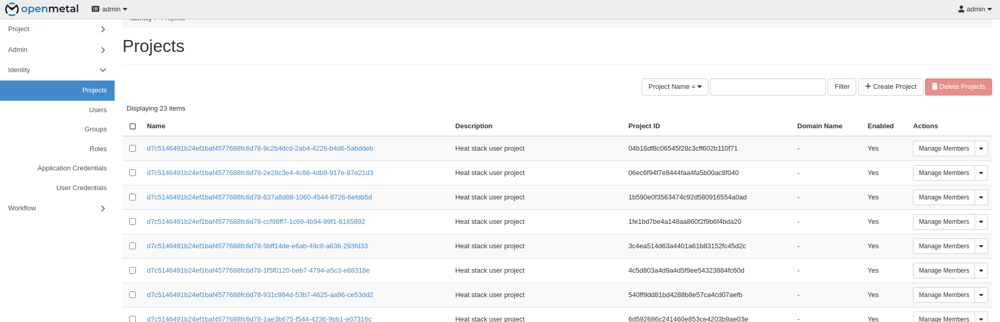
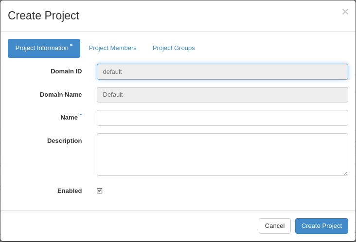
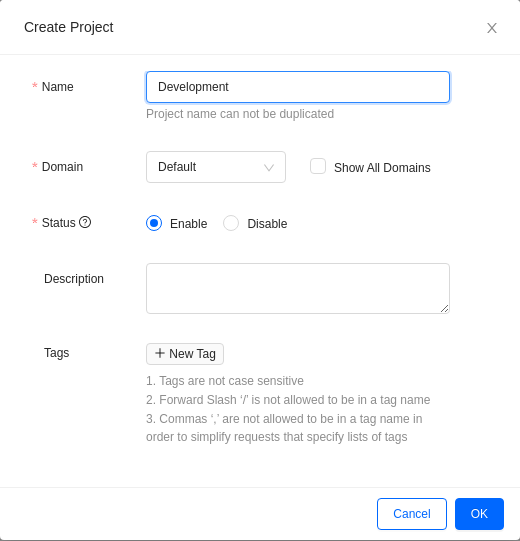
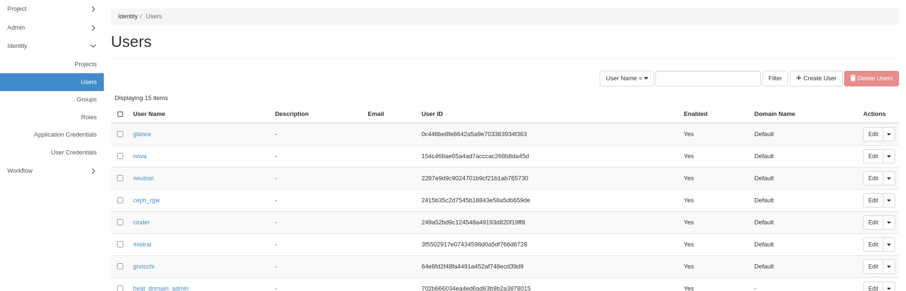
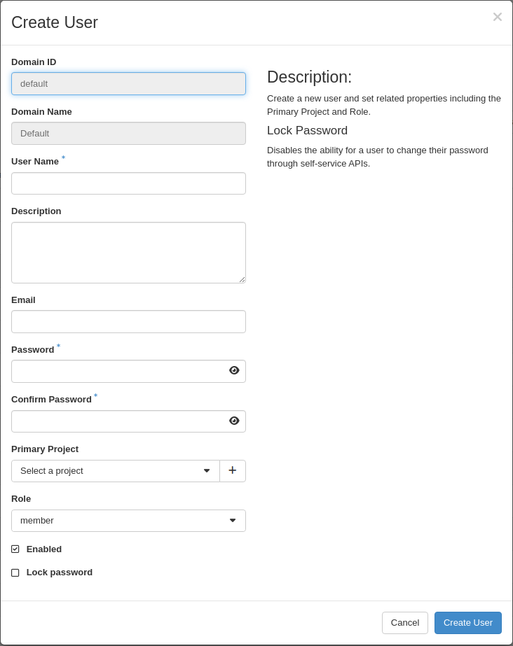
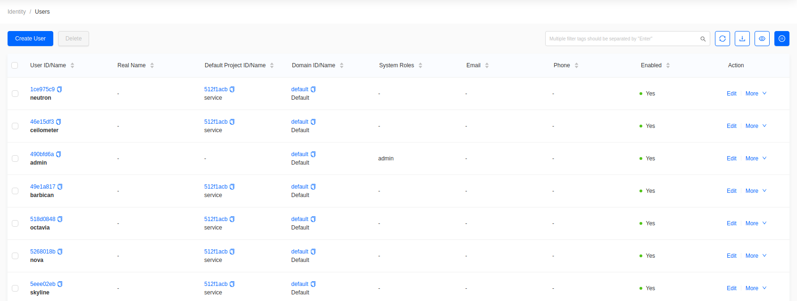
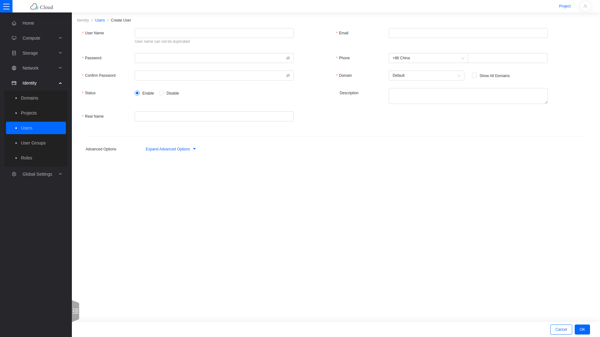

import Tabs from '@theme/Tabs';
import TabItem from '@theme/TabItem';

# Create a User and Project

## Create a project

<Tabs groupId="dashboard">
<TabItem value="hz" label="Horizon" default>

Go to **Identity -> Projects**.

Click **Create Project**.

- **Name**: the project name. This example uses **Development**.
- **Domain ID** and **Domain Name**: read-only, taken from your session.
- **Enabled**: leave checked.
- **Description**: optional.

The **Project Members**, **Project Groups**, and **Quotas** tabs assign users and set limits during creation. Both can be changed later.

Click **Create Project**.

</TabItem>
<TabItem value="skyline" label="Skyline">

Switch to the **Administrator** console, then go to **Identity -> Projects**.

Click **Create Project**.

- **Name**: the project name. This example uses **Development**.
- **Domain**: leave as `Default` unless you use multiple domains.
- **Status**: leave enabled.
- **Description**, **Tags**: optional.

Click **OK**.

</TabItem>
</Tabs>

## Set project quotas

<Tabs groupId="dashboard">
<TabItem value="hz" label="Horizon" default>

Find the project in the list, then choose **Modify Quotas** from the actions menu.

</TabItem>
<TabItem value="skyline" label="Skyline">

Find the project in the list, then choose **More -> Edit Quota**.

</TabItem>
</Tabs>

Quotas cap what the project may consume — instances, vCPUs, memory, volumes, floating IPs, and security groups. Leave a quota blank for unlimited.

## Create a user

<Tabs groupId="dashboard">
<TabItem value="hz" label="Horizon" default>

Go to **Identity -> Users**.

Click **Create User**.

- **User Name**: the login name.
- **Password** and **Confirm Password**: the user's initial password.
- **Domain ID** and **Domain Name**: read-only.
- **Primary Project** and **Role**: assign the user to a project and give it a role.
- **Email**, **Description**: optional.
- **Enabled**: leave checked.

Click **Create User**.

</TabItem>
<TabItem value="skyline" label="Skyline">

Go to **Identity -> Users**.

Click **Create User**. This opens a full page rather than a dialog.

- **Username**: the login name.
- **Password** and **Confirm Password**: the user's initial password.
- **Domain**: leave as `Default`.
- **Project** and **Role**: assign the user to a project and give it a role.
- **Email**, **Phone**, **Real Name**, **Description**: optional.

Click **OK**.

</TabItem>
</Tabs>

The new user can now sign in and will see only the projects it belongs to.

## Roles

- `member` — normal tenant access within assigned projects.
- `reader` — read-only access.
- `admin` — full cloud administration.

Grant `admin` only to operators who administer the whole cloud.
