import Tabs from '@theme/Tabs';
import TabItem from '@theme/TabItem';

# How to Create an Instance

This guide creates a private network, a security group, a key pair, and an instance, then attaches a floating IP so the instance is reachable from outside the cloud.

## Create a network and router

<Tabs groupId="dashboard">
<TabItem value="hz" label="Horizon" default>

Horizon creates the network and the router separately.

Go to **Project -> Network -> Networks**.

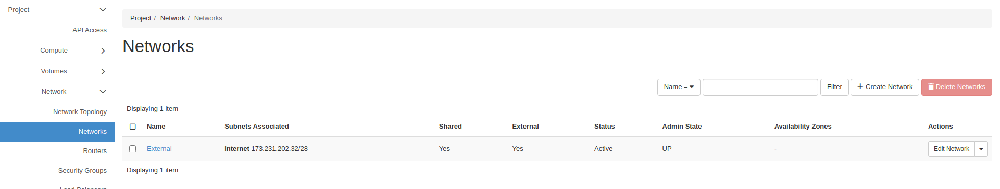

Click **Create Network**. The form has three tabs.

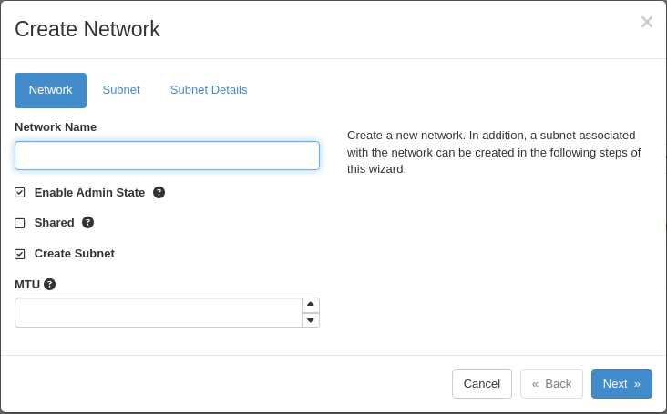

- **Network** tab — **Network Name**: **Private**. Leave **Create Subnet** checked.
- **Subnet** tab — **Subnet Name**: **private-subnet**. **Network Address**: `192.168.0.0/24`.
- **Subnet Details** tab — leave **Enable DHCP** checked. DNS name servers and allocation pools are optional.

Click **Create**.

Next go to **Project -> Network -> Routers**.

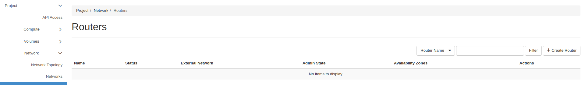

Click **Create Router**.

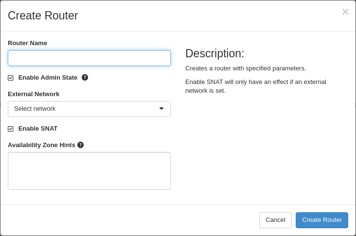

- **Router Name**: **Router**.
- **External Network**: **External**.

Click **Create Router**, then open the router, choose the **Interfaces** tab, and click **Add Interface** to attach **private-subnet**.

</TabItem>
<TabItem value="skyline" label="Skyline">

**Quick Create** builds the network, its subnet, and an attached router in one step.

Go to **Network -> Networks**.

Click **Quick Create**.

Fill in the form.

- **Network Name**: **Private**.
- **Subnet Name**: **private-subnet**.
- **Subnet CIDR**: a private range, for example `192.168.0.0/24`.
- **Gateway IP** and **DNS**: filled automatically.
- **Create and Attach Router**: check this, then set **Router Name**.
- **Options -> External Gateway**: check this and select **External**, or the router has no route out and floating IPs will not work.

Click **OK**.

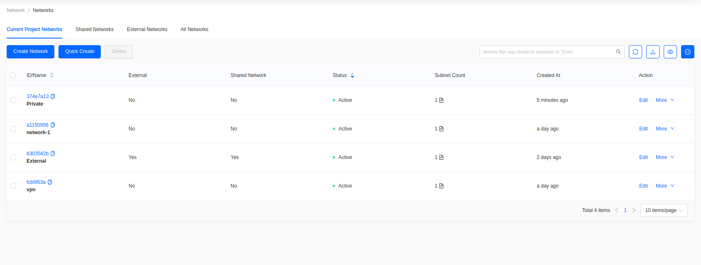

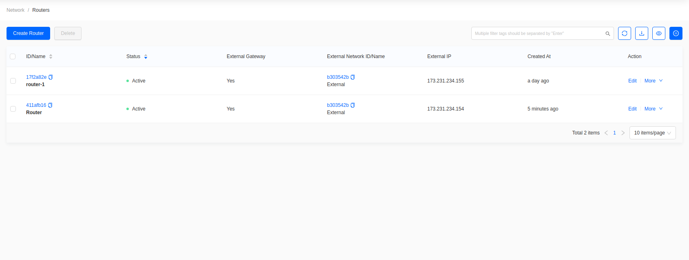

To build the pieces separately, use **Create Network** on this page and **Create Router** under **Network -> Routers**, then attach the subnet with **More -> Connect Subnet**.

</TabItem>
</Tabs>

### View the topology

<Tabs groupId="dashboard">
<TabItem value="hz" label="Horizon" default>

Go to **Project -> Network -> Network Topology**.

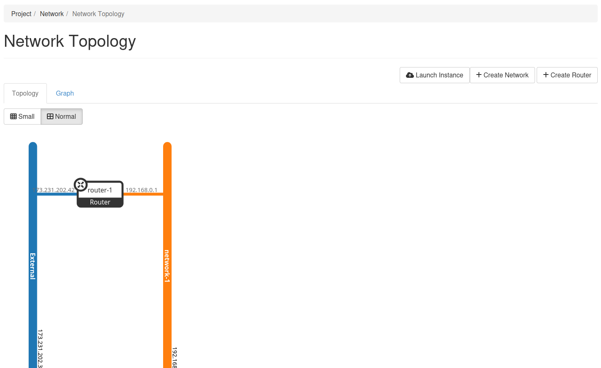

The **Graph** tab shows the same data as a node graph. **Small** and **Normal** change the level of detail.

</TabItem>
<TabItem value="skyline" label="Skyline">

Go to **Network -> Topology**.

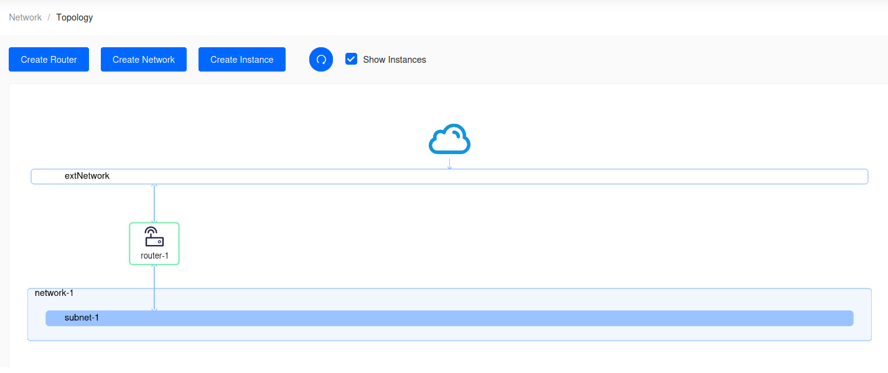

Clear **Show Instances** to reduce the diagram to networks and routers.

</TabItem>
</Tabs>

## Create a security group

Security groups control traffic to and from instances. The **default** group denies all inbound traffic and allows all outbound traffic.

<Tabs groupId="dashboard">
<TabItem value="hz" label="Horizon" default>

Go to **Project -> Network -> Security Groups**.

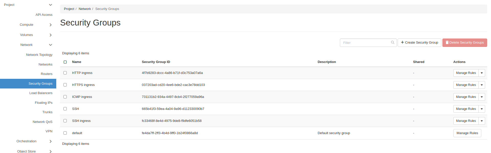

Click **Create Security Group**, name it **SSH**, then click **Create Security Group**.

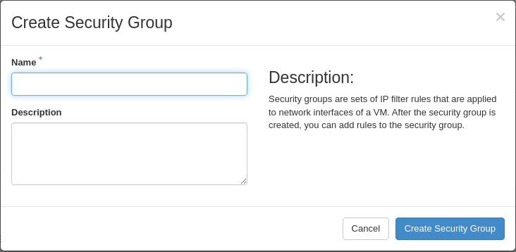

Click **Manage Rules** on the new group.

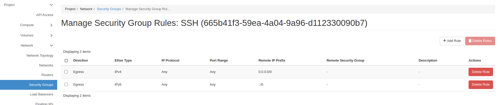

Click **Add Rule**.

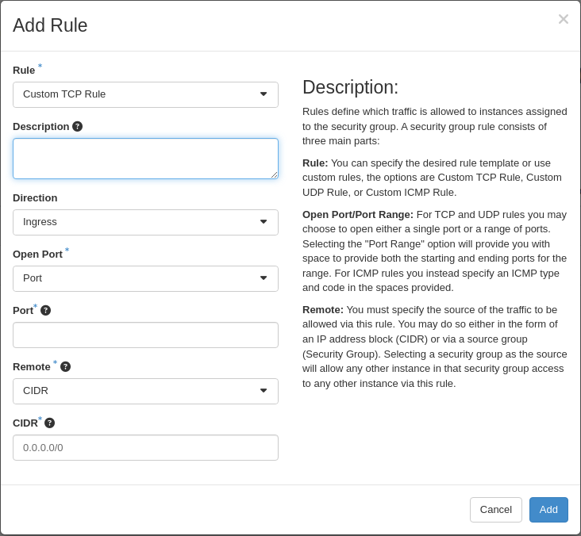

- **Rule**: **SSH**, which presets TCP port 22.
- **Remote**: **CIDR**.
- **CIDR**: the source allowed to connect.

Click **Add**.

</TabItem>
<TabItem value="skyline" label="Skyline">

Go to **Network -> Security Groups**.

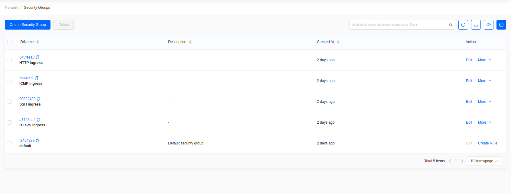

Click **Create Security Group**, name it **SSH**, then click **OK**.

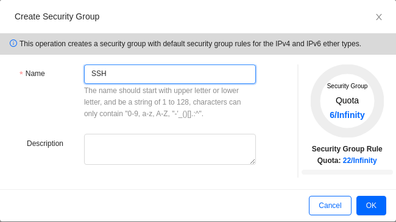

Open the **SSH** group.

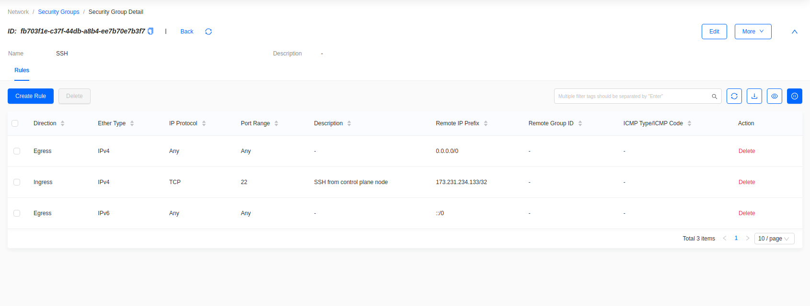

Click **Create Rule**.

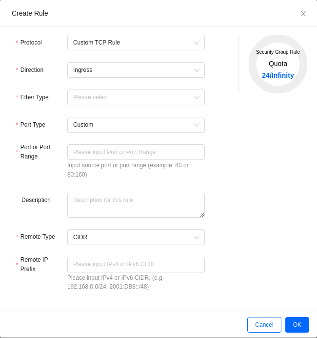

- **Protocol**: TCP. **Direction**: Ingress. **Ether Type**: IPv4.
- **Port or Port Range**: `22`.
- **Remote Type**: CIDR. **Remote IP Prefix**: the source allowed to connect.

Click **OK**.

</TabItem>
</Tabs>

Open only the ports you need, to the narrowest source range that works. Use the IP of a control plane node rather than `0.0.0.0/0`.

## Add a key pair

An SSH key is injected at boot. It cannot be added to a running instance.

<Tabs groupId="dashboard">
<TabItem value="hz" label="Horizon" default>

Go to **Project -> Compute -> Key Pairs**.

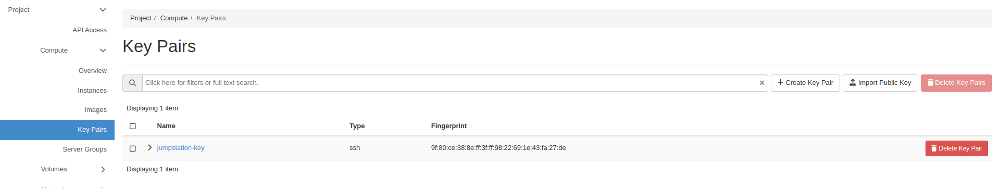

Click **Create Key Pair** to generate one, or **Import Public Key** to upload an existing key.

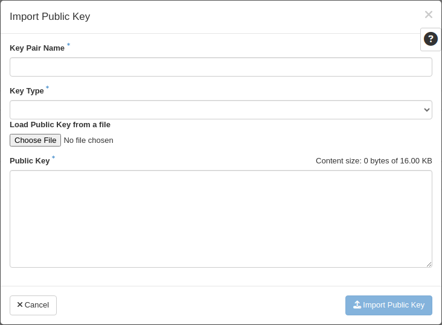

- **Key Pair Name**: the name shown when launching an instance.
- **Key Type**: **SSH Key**.
- **Public Key**: paste the key, or load it from a file.

</TabItem>
<TabItem value="skyline" label="Skyline">

Go to **Compute -> Key Pairs**.

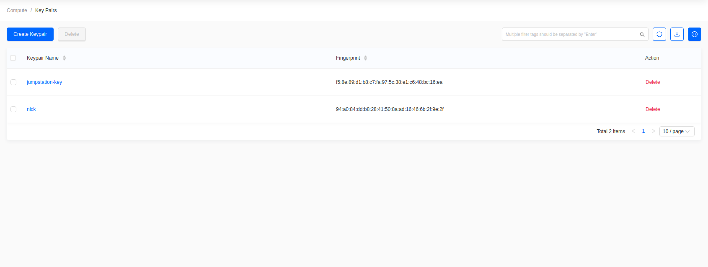

Click **Create Keypair**.

- **Create Type**: generate a new key pair, or import an existing public key.
- **Keypair Name**: the name shown when launching an instance.
- **Public Key**: paste the public key when importing.

</TabItem>
</Tabs>

To create a key pair on a control plane node first, see [Create SSH Key Pair for an OpenStack Control Plane Node](../command-line/create-SSH-key).

## Create the instance

<Tabs groupId="dashboard">
<TabItem value="hz" label="Horizon" default>

Go to **Project -> Compute -> Instances** and click **Launch Instance**. This opens a wizard whose steps are listed down the left side.

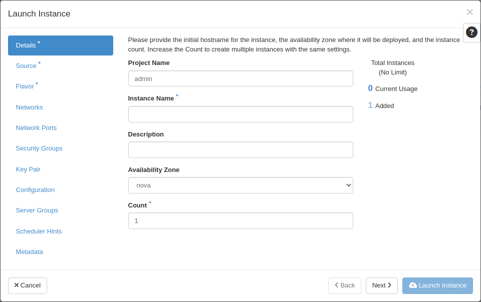

- **Details** — **Instance Name**, **Availability Zone**, **Count**.
- **Source** — **Select Boot Source**: **Image**. Leave **Create New Volume** set to **Yes** to boot from a Cinder volume in Ceph. Pick the image with its up arrow.
- **Flavor** — pick the flavor with its up arrow.
- **Networks** — select **Private**.
- **Security Groups** — select **SSH**.
- **Key Pair** — select the key pair, or import one here.

The remaining steps are optional. Click **Launch Instance**.

</TabItem>
<TabItem value="skyline" label="Skyline">

Go to **Compute -> Instances** and click **Create Instance**. This opens a four-step wizard.

### Step 1: Base Config

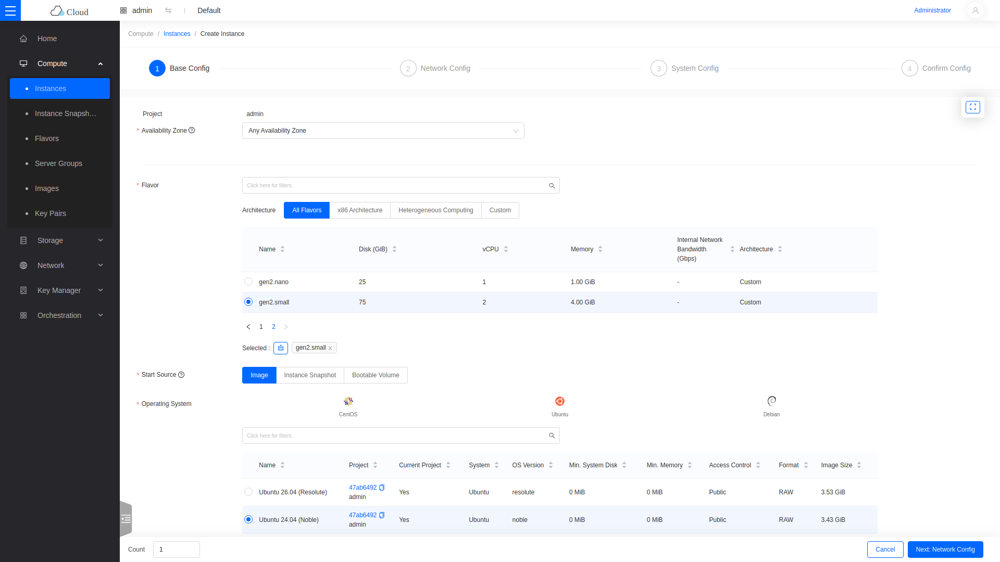

- **Flavor**: the vCPU, memory, and disk size. This example uses **gen2.small**.
- **Start Source**: **Image**. Then pick a distribution tab and the image.
- **Boot From Volume**: **Yes** creates a Cinder volume from the image, stored in Ceph.
- **System Disk**: choose a volume **Type**, then a **Size** at least the flavor's disk size, or the wizard will not advance.

### Step 2: Network Config

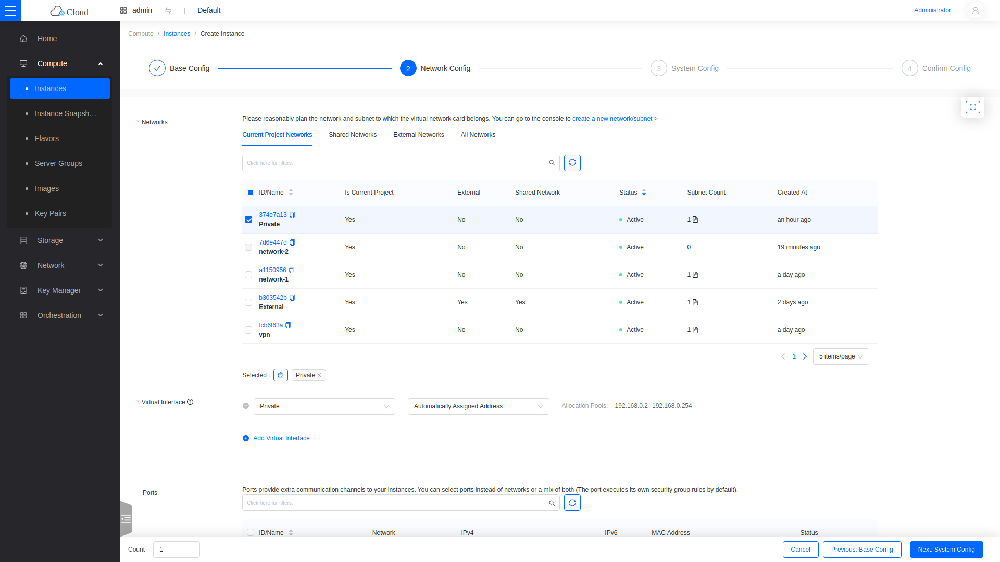

Select the **Private** network and the **SSH** security group.

### Step 3: System Config

Set the **Name**, set **Login Type** to **Keypair**, and select the key pair.

### Step 4: Confirm Config

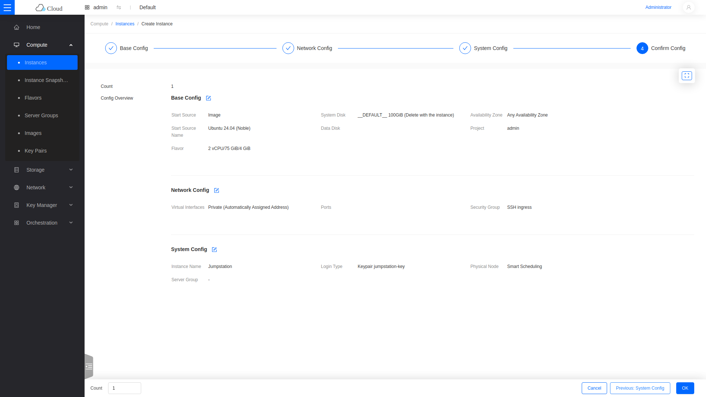

Review the summary and click **OK**.

</TabItem>
</Tabs>

Attaching an instance directly to **External** consumes a public IP and exposes it to the Internet. Use a private network and a floating IP instead.

The instance builds in a few minutes.

<Tabs groupId="dashboard">
<TabItem value="hz" label="Horizon" default>

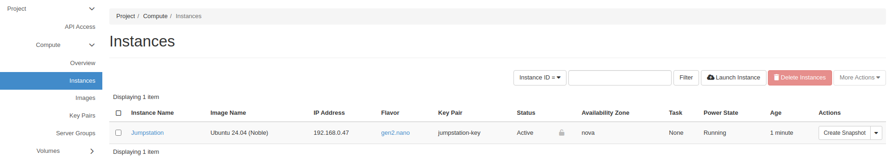

</TabItem>
<TabItem value="skyline" label="Skyline">

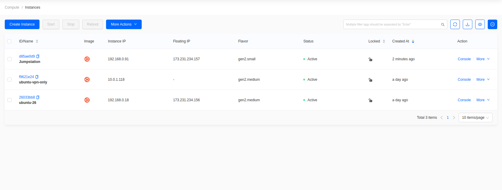

</TabItem>
</Tabs>

## Attach a floating IP

A floating IP makes the instance reachable from outside the cloud.

<Tabs groupId="dashboard">
<TabItem value="hz" label="Horizon" default>

Go to **Project -> Network -> Floating IPs**.

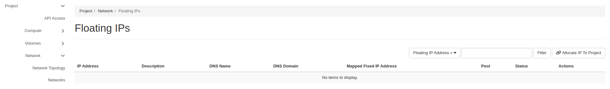

Click **Allocate IP To Project**.

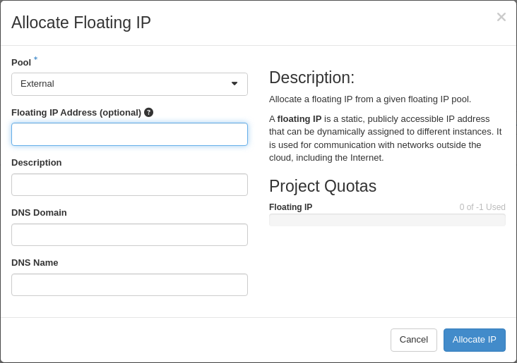

Select **External** as the **Pool**, then click **Allocate IP**.

Find the new address and click **Associate**, then select the instance's port.

</TabItem>
<TabItem value="skyline" label="Skyline">

Go to **Network -> Floating IPs**.

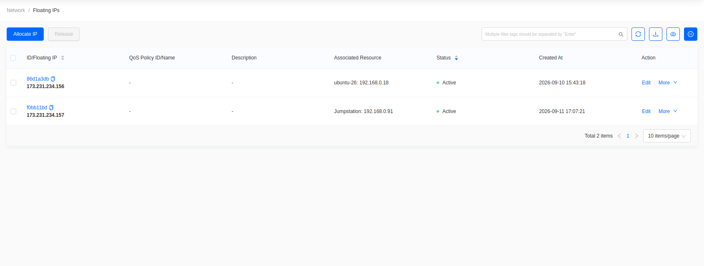

Click **Allocate IP**.

Select the **External** network, then click **OK**.

Find the new address and choose **More -> Associate**, then select the instance and its port.

</TabItem>
</Tabs>

The instance is now reachable over SSH from any source permitted by the **SSH** security group rule.
