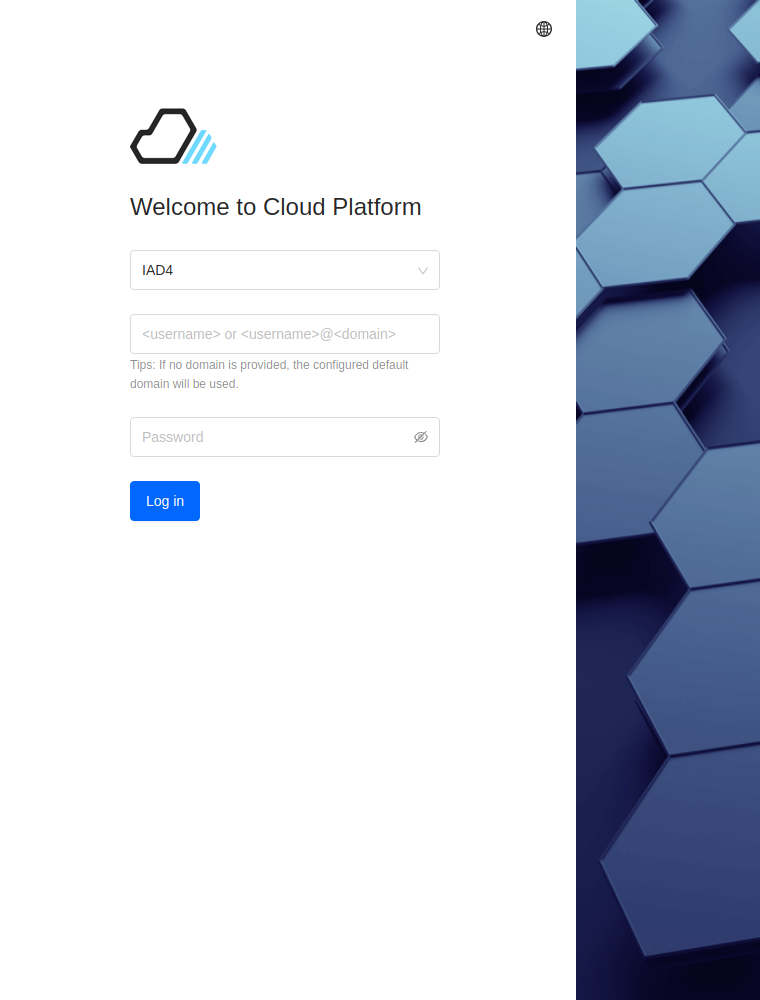
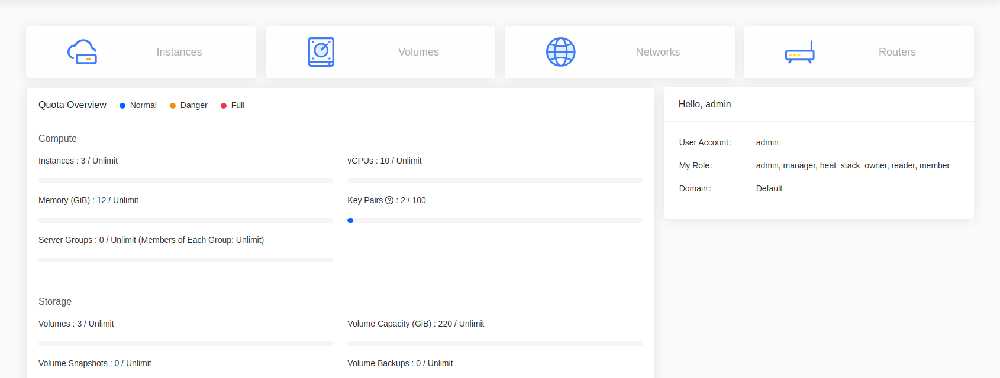
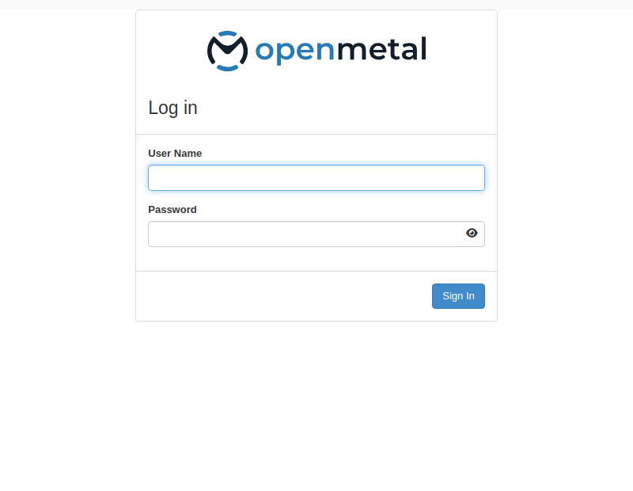

import Tabs from '@theme/Tabs';
import TabItem from '@theme/TabItem';

# Getting Started with the Dashboard

PCC v4 ships two dashboards. Skyline is the default and is served at your cloud's dashboard URL. Horizon remains available on port 9999.

Every dashboard procedure in this manual is shown for both. Pick a tab and the rest of the page follows your choice.

## Log in to OpenMetal Central

<!-- SCREENSHOT NEEDED: OpenMetal Central login page.
     Cannot be captured automatically; Central is not reachable from the docs build
     environment. Replace this comment with:  -->

Sign in at [OpenMetal Central](https://central.openmetal.io/).

## Open your cloud's details page

<!-- SCREENSHOT NEEDED: Central cloud details / Manage Cloud page.
     Replace with:  -->

Select your cloud to open its details page.

## Find the dashboard URL

<!-- SCREENSHOT NEEDED: Central showing the dashboard URL.
     Replace with:  -->

The dashboard URL opens Skyline. For Horizon, append `:9999` to the same address.

## Obtain the dashboard password

<!-- SCREENSHOT NEEDED: Central "show password" control.
     Replace with:  -->

The `admin` password is shown in Central. Both dashboards take the same credentials.

To read it from a control plane node instead:

    grep keystone_admin_password /etc/kolla/passwords.yml

<!-- SCREENSHOT NEEDED: Central hardware assets page (used to find node IPs for SSH).
     Replace with:  -->

## Log in

<Tabs groupId="dashboard">
<TabItem value="skyline" label="Skyline" default>

Enter the region, username `admin`, and the password. Leave the domain blank to use the default domain.

The home page shows quota usage for compute, storage, and network.

</TabItem>
<TabItem value="hz" label="Horizon">

Open `https://<VIP>:9999`.

Enter the username `admin` and the password.

The overview page shows quota usage for the current project.

</TabItem>
</Tabs>

## Consoles and navigation

<Tabs groupId="dashboard">
<TabItem value="skyline" label="Skyline" default>

Skyline separates tenant work from administration:

- **Project console** — instances, volumes, networks, stacks. The default view.
- **Administrator console** — projects, users, roles, hypervisors, system info.

Switch between them with the **Administrator** link in the top right.

</TabItem>
<TabItem value="hz" label="Horizon">

Horizon groups the same work under tabs in the left sidebar:

- **Project** — instances, volumes, networks, stacks.
- **Admin** — hypervisors, host aggregates, system information.
- **Identity** — projects, users, roles.

</TabItem>
</Tabs>
