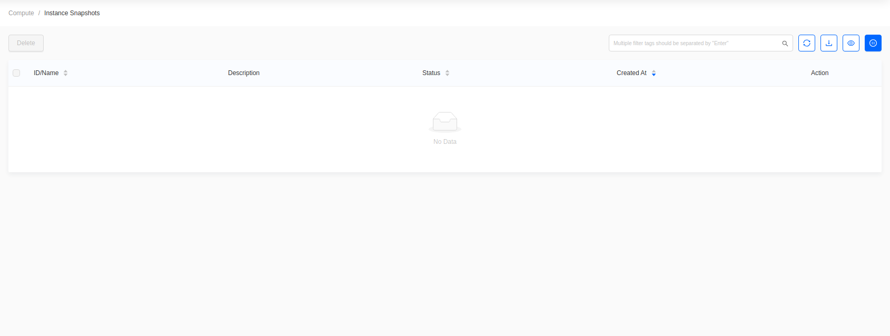

# Manage and Upload Images

Images are the operating system templates instances boot from.

## View images

Go to **Compute -> Images**.

The list shows the distribution, OS version, minimum disk and memory,
visibility, disk
format, and size. Public images are available to every project.

## Upload an image

Click **Create Image**. This opens a full page rather than a dialog.

- **Image Name**: the name shown in the image list.
- **Upload Type**: upload a local **File**, or fetch a **File URL**.
- **Disk Format**: `QCOW2` or `RAW`. Ceph-backed clouds perform best with `RAW`,
  because QCOW2 images are converted on upload.
- **OS** and **OS Version**: used to group the image under a distribution tab.
- **OS Admin**: the default login account, for example `ubuntu` or `cloud-user`.
- **Min. System Disk** and **Min. Memory**: the floor a flavor must meet to use
  this
  image.
- **Visibility**: **Public** shares the image with every project, **Private**
  keeps it
  in the current project.
- **Protection**: enable to block deletion.

Click **OK**. The image stays in `queued` or `saving` until the upload finishes.

## Snapshot a running instance

A snapshot captures an instance's disk as a new image.

Go to **Compute -> Instances**, find the instance, then choose
**More -> Create Snapshot**.

Snapshots appear under **Compute -> Instance Snapshots**.

Shut the instance down before snapshotting if the workload writes to disk, so
the
snapshot is filesystem-consistent.
