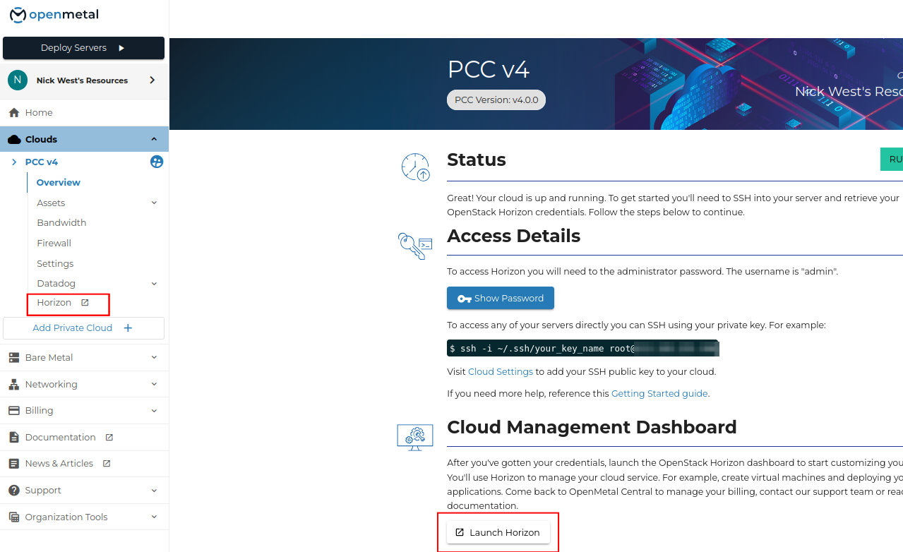
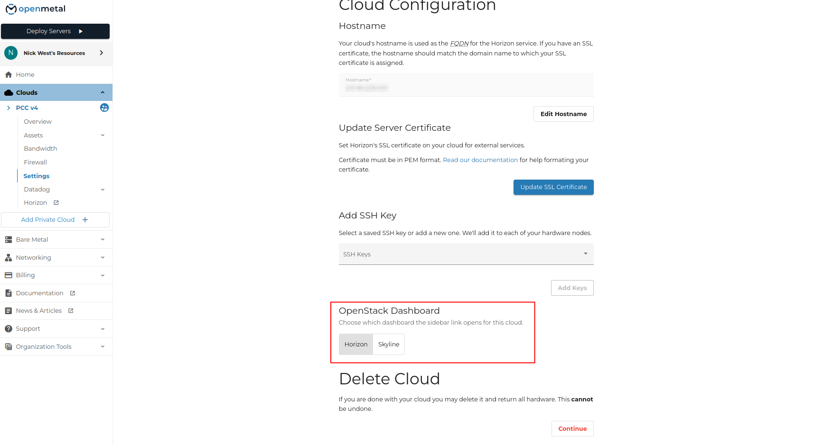
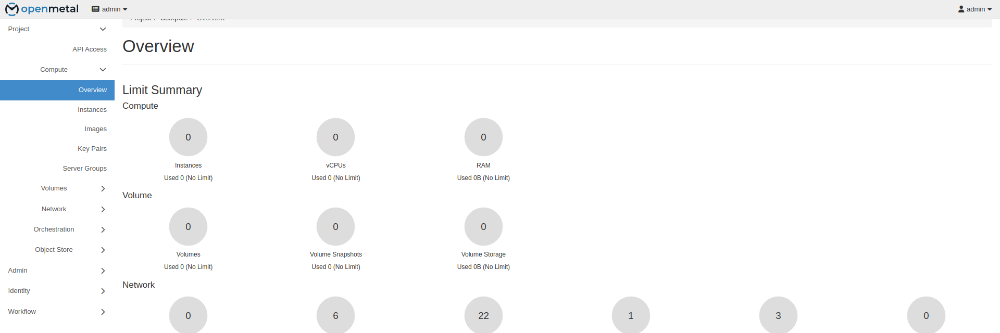
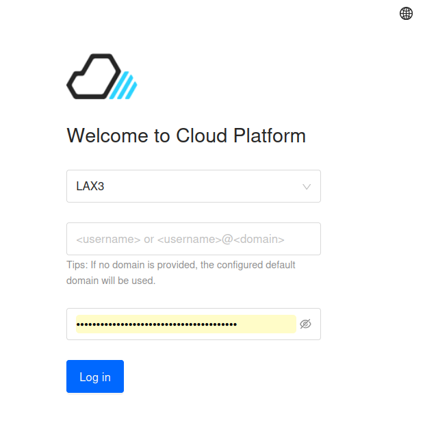
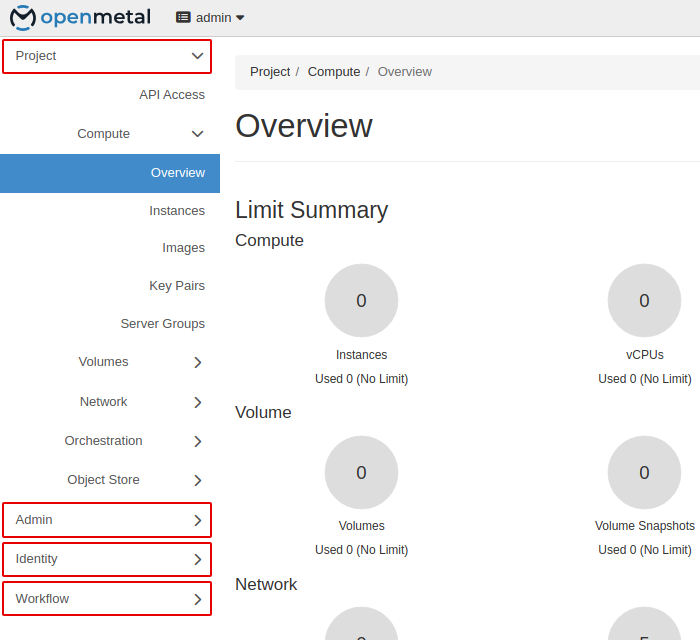
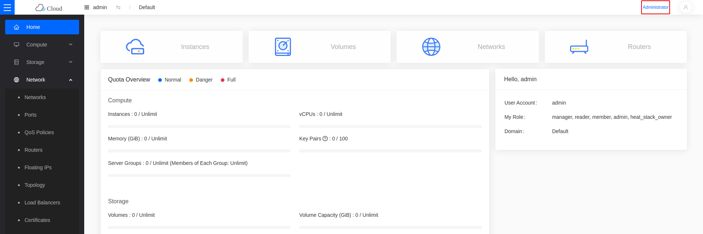

import Tabs from '@theme/Tabs';
import TabItem from '@theme/TabItem';

# Getting Started with the Dashboard

PCC v4 deploys two dashboards. Both accept the same credentials and talk to the same OpenStack APIs, so a change made in one appears in the other.

| Dashboard | URL | |
|---|---|---|
| Horizon | `https://<VIP>:9999` | Default |
| Skyline | `https://<VIP>` | |

Horizon is the default: it is what the dashboard link in OpenMetal Central opens. See [Change the default dashboard](#change-the-default-dashboard) to switch to Skyline.

Every dashboard procedure in this manual is shown for both. Pick a tab and the rest of the page follows your choice.

## Log in to OpenMetal Central

Sign in at [OpenMetal Central](https://central.openmetal.io/).

## Open your cloud's details page

Select your cloud in the left sidebar, then open **Overview**.

This page carries the access details, the SSH example for your nodes, and the dashboard link.

## Obtain the dashboard password

Under **Access Details**, click **Show Password**. The username is `admin`.

To read it from a control plane node instead:

    grep keystone_admin_password /etc/kolla/passwords.yml

## Find the dashboard URL

Two places open the dashboard:

- The dashboard link under your cloud's entry in the left sidebar.
- The **Launch** button in the **Cloud Management Dashboard** section of the Overview page.

Both are labelled with whichever dashboard is currently selected, and both open that one.

To reach the other dashboard without changing the selection, go to its URL directly.

## Change the default dashboard

Open **Settings** for your cloud. Under **Cloud Configuration -> OpenStack Dashboard**, choose **Horizon** or **Skyline**.

The setting controls which dashboard the sidebar link opens. It does not stop the other one from running — both stay reachable at their own URLs.

## Log in

<Tabs groupId="dashboard">
<TabItem value="hz" label="Horizon" default>

Open `https://<VIP>:9999`.

Enter the username `admin` and the password.

The overview page shows quota usage for the current project.

</TabItem>
<TabItem value="skyline" label="Skyline">

Open `https://<VIP>`.

Pick the region, then enter the username `admin` and the password. Leave the domain off to use the default domain.

The home page shows quota usage for compute, storage, and network.

</TabItem>
</Tabs>

## Consoles and navigation

<Tabs groupId="dashboard">
<TabItem value="hz" label="Horizon" default>

Horizon groups work under sections in the left sidebar:

- **Project** — instances, volumes, networks, stacks.
- **Admin** — hypervisors, host aggregates, system information.
- **Identity** — projects, users, roles.
- **Workflow** — Mistral workbooks, workflows, and executions.

</TabItem>
<TabItem value="skyline" label="Skyline">

Skyline separates tenant work from administration:

- **Project console** — instances, volumes, networks, stacks. The default view.
- **Administrator console** — projects, users, roles, hypervisors, system info.

Switch between them with the **Administrator** link in the top right.

</TabItem>
</Tabs>
