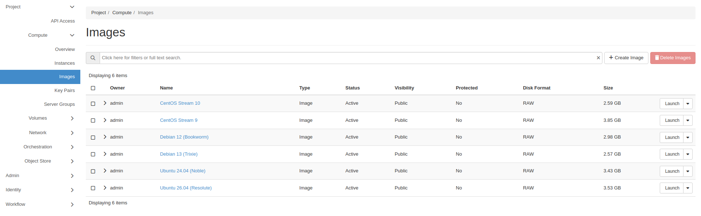
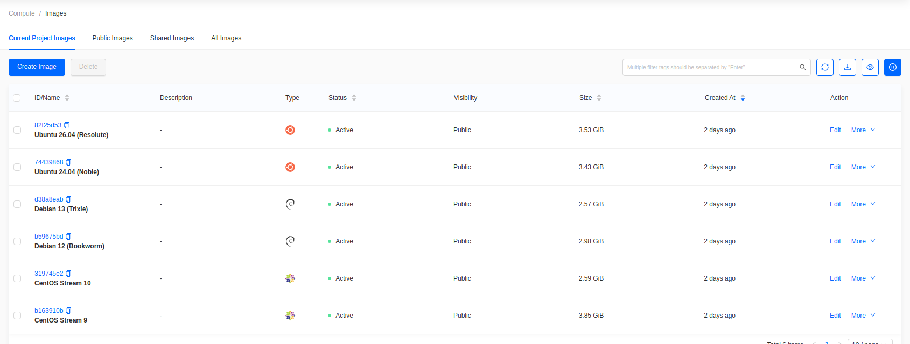
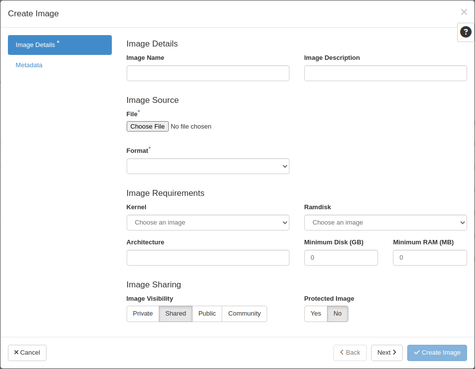
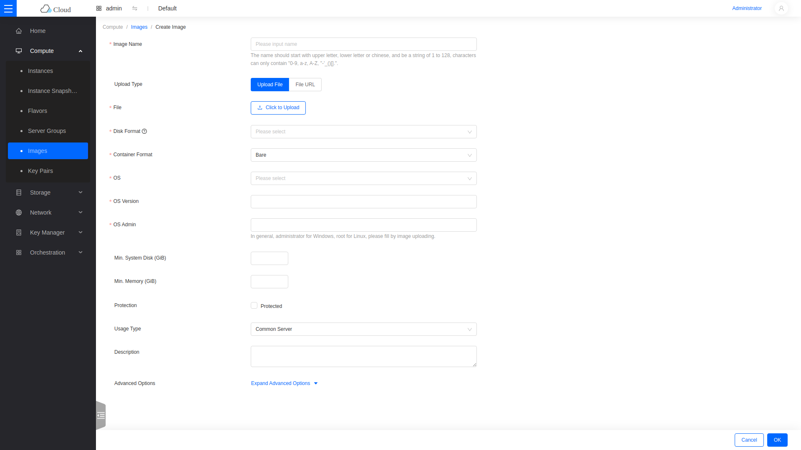
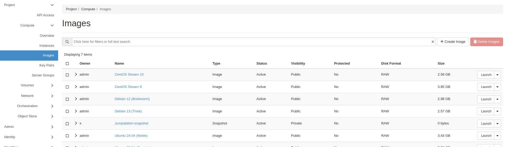

import Tabs from '@theme/Tabs';
import TabItem from '@theme/TabItem';

# Manage and Upload Images

Images are the operating system templates instances boot from.

## View images

<Tabs groupId="dashboard">
<TabItem value="hz" label="Horizon" default>

Go to **Project -> Compute -> Images**.

</TabItem>
<TabItem value="skyline" label="Skyline">

Go to **Compute -> Images**.

</TabItem>
</Tabs>

The list shows the distribution, OS version, minimum disk and memory, visibility, disk format, and size. Public images are available to every project.

## Upload an image

<Tabs groupId="dashboard">
<TabItem value="hz" label="Horizon" default>

Click **Create Image**.

- **Image Name**: the name shown in the image list.
- **Image Source**: upload a local **File**, or fetch a **URL**.
- **Format**: `QCOW2` or `RAW`.
- **Image Requirements**: minimum disk and memory a flavor must meet.
- **Visibility**: **Public** shares the image with every project.
- **Protected**: enable to block deletion.

Click **Create Image**.

</TabItem>
<TabItem value="skyline" label="Skyline">

Click **Create Image**. This opens a full page rather than a dialog.

- **Image Name**: the name shown in the image list.
- **Upload Type**: upload a local **File**, or fetch a **File URL**.
- **Disk Format**: `QCOW2` or `RAW`.
- **OS** and **OS Version**: used to group the image under a distribution tab.
- **OS Admin**: the default login account, for example `ubuntu` or `cloud-user`.
- **Min. System Disk** and **Min. Memory**: the floor a flavor must meet.
- **Visibility**: **Public** shares the image with every project.
- **Protection**: enable to block deletion.

Click **OK**.

</TabItem>
</Tabs>

Ceph-backed clouds perform best with `RAW`, because QCOW2 images are converted on upload.

The image stays in `queued` or `saving` until the upload finishes.

## Snapshot a running instance

A snapshot captures an instance's disk as a new image.

<Tabs groupId="dashboard">
<TabItem value="hz" label="Horizon" default>

Go to **Project -> Compute -> Instances**, find the instance, then choose **Create Snapshot**. Snapshots appear under **Project -> Compute -> Images** with a type of `Snapshot`.

</TabItem>
<TabItem value="skyline" label="Skyline">

Go to **Compute -> Instances**, find the instance, then choose **More -> Create Snapshot**. Snapshots appear under **Compute -> Instance Snapshots**.

</TabItem>
</Tabs>

Shut the instance down before snapshotting if the workload writes to disk, so the snapshot is filesystem-consistent.
