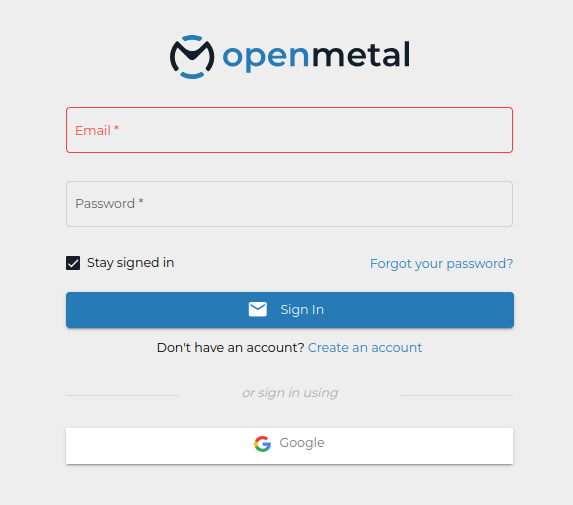
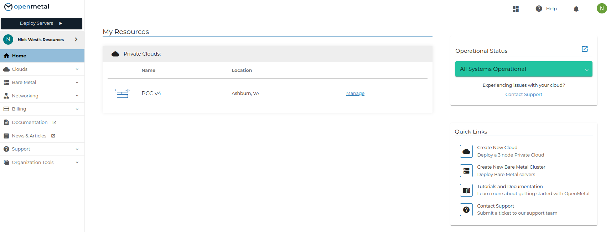
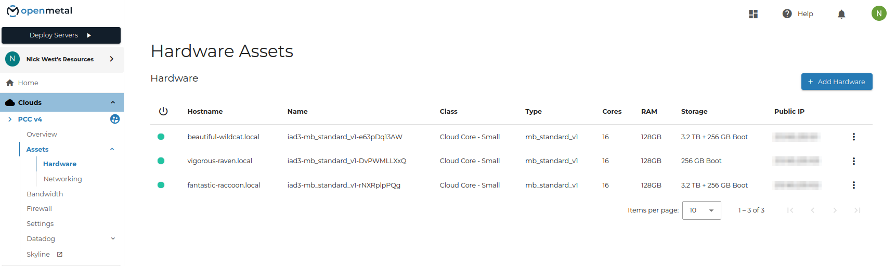
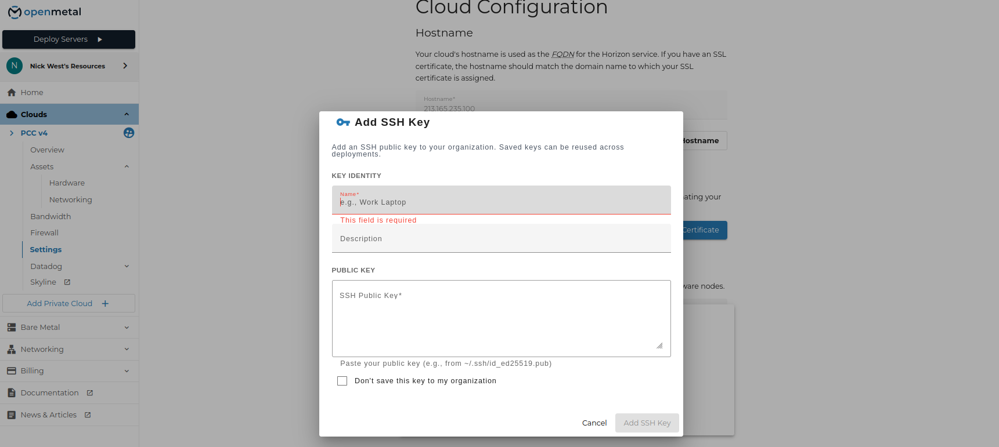
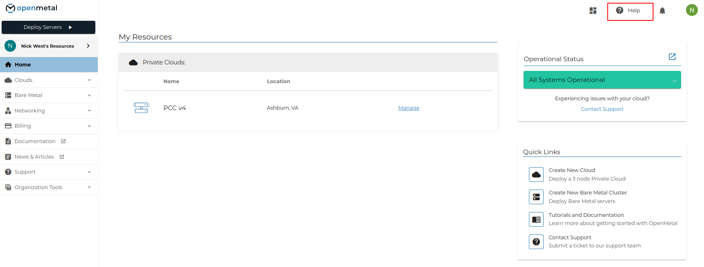
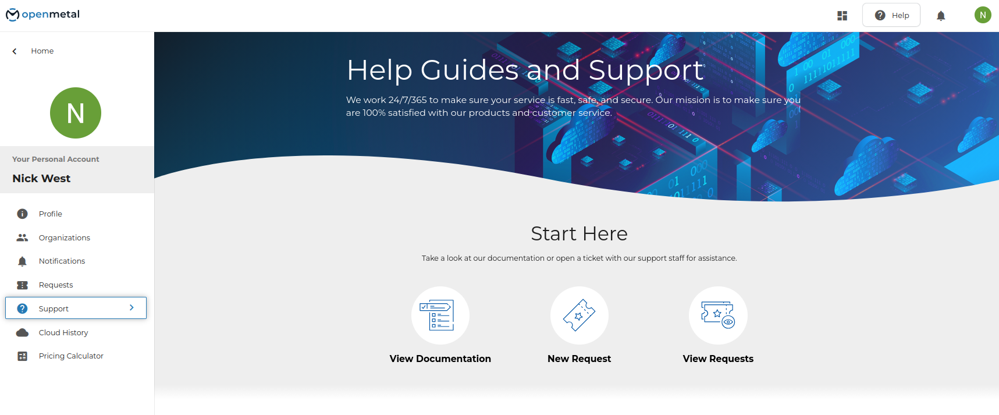
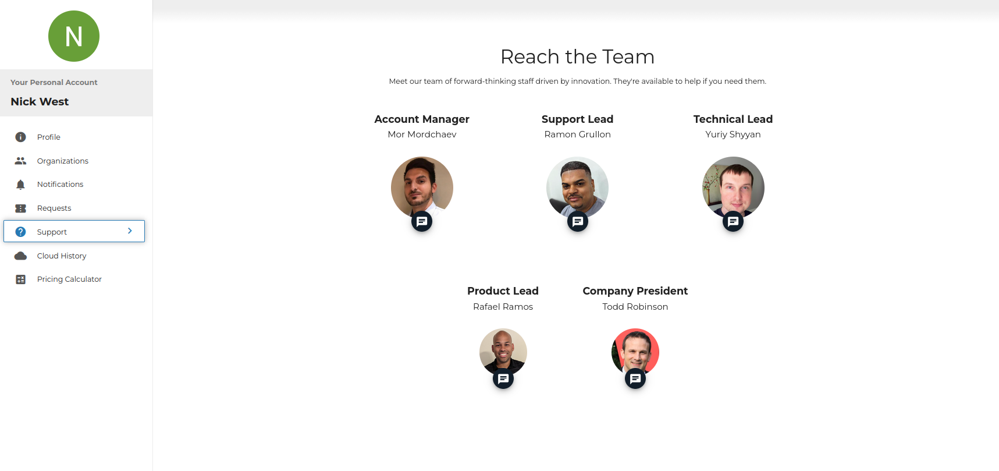
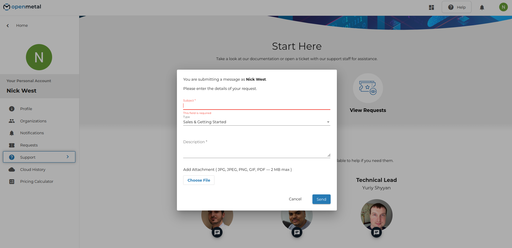
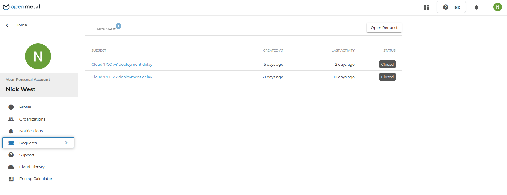

# Introduction to OpenMetal Central and Your Private Cloud Core

## Introduction

We begin by introducing you to OpenMetal Central and explain how to obtain an overview of your Private Cloud. Next, we detail where to view the assets that comprise your cloud, point you to existing documentation, and how to submit and view support requests.

## A Brief Overview of Your OpenMetal Private Cloud

OpenMetal Private Clouds are deployed with OpenStack to three bare metal servers. These three servers comprise the Private Cloud Core. To OpenStack, these three servers are considered the control plane. Private Clouds are deployed with Ceph, providing your cloud with shared storage.

## Hardware Assets

The nodes in your cloud are displayed in [OpenMetal Central](https://central.openmetal.io).



**Figure 1:** OpenMetal Central login page

The Home page lists your resources. Click **Manage** next to your cloud to open it.



**Figure 2:** OpenMetal Central home page

In your cloud's sidebar, go to **Assets -> Hardware**. This page lists the hardware nodes in your Private Cloud, with each node's class, type, cores, memory, storage, and public IP. **Assets -> Networking** lists the Inventory and Provider IP blocks.



**Figure 3:** Hardware Assets page

The example above is a Demo Private Cloud. Your Private Cloud can have different hardware based on the options selected at deployment:

- 3 **Cloud Core - Small** control plane nodes of type `mb_standard_v1`
- Inventory IP address blocks
- Provider IP address blocks

**Note**: With our Private Clouds, OpenStack is deployed with three hyper-converged control plane nodes.

## Add SSH Key to Cloud

You can access your control plane nodes directly through SSH as the root user by adding your SSH key in Central.

1. In your cloud's sidebar, click **Settings**.
2. Scroll to the **Add SSH Key** section.
3. Open the **SSH Keys** dropdown. Select a saved key, or choose to add a new one.

   

   **Figure 4:** Add SSH Key

   - **Name**: a label for the key, for example `Work Laptop`. Required.
   - **Description**: optional.
   - **SSH Public Key**: paste the contents of your public key, for example `~/.ssh/id_ed25519.pub`. Required.
   - **Don't save this key to my organization**: check this to use the key for this cloud only. Saved keys can be reused across deployments.

4. Click **Add SSH Key**, then click **Add Keys** to apply the selected keys to your nodes.

### Access your hardware nodes

Access your servers with the new key:

```shell
ssh -i ~/.ssh/your_key_name root@<server-ip>
```

## How to Get Support

Documentation and support requests are both reached through **Help** in the top right of OpenMetal Central.



**Figure 5:** Help in OpenMetal Central

The Help Guides and Support page starts with three options.



**Figure 6:** Help Guides and Support

- **View Documentation** — the OpenMetal documentation index, covering configuration, deployment, and common issues.
- **New Request** — open a support ticket.
- **View Requests** — the tickets already submitted under your account.

### Reach an individual team member

Further down the same page is **Reach the Team**. Click the chat icon under a person to contact them directly.



**Figure 7:** Reach the Team

### Submit a support ticket

Click **New Request**.



**Figure 8:** New support request

- **Subject**: required.
- **Type**: the category of request.
- **Description**: required.
- **Add Attachment**: JPG, JPEG, PNG, GIF, or PDF, 2 MB maximum.

Click **Send**.

### View submitted requests

Click **View Requests**, or go to **Requests** in the sidebar. Each row shows the subject, when it was created, its last activity, and its status. Click a subject to read the full thread and any replies.



**Figure 9:** Submitted support requests

If you are the administrator of the Private Cloud, you can see all support requests regarding your Private Cloud.
