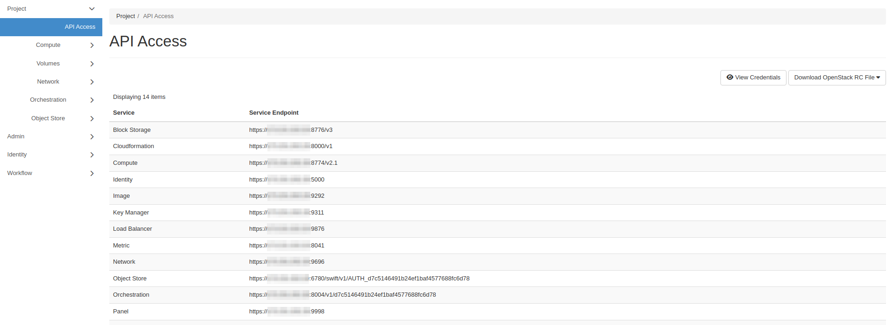
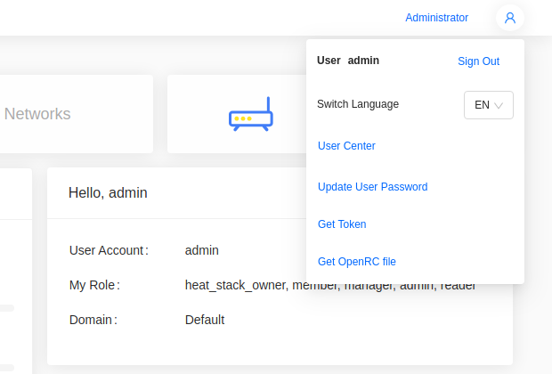

import Tabs from '@theme/Tabs';
import TabItem from '@theme/TabItem';

# How to Install and Use OpenStack's CLI

OpenStackClient manages your cloud from the command line.

## Install OpenStackClient

These steps install OpenStackClient on your local machine running Ubuntu 24.04. Other operating systems differ mainly in how the Python virtual environment is created.

Ubuntu 24.04 marks its system Python as externally managed, so `pip` cannot install into it. Install into a virtual environment instead.

**Step 1** -- Install the `venv` module

    sudo apt update
    sudo apt install python3-venv

**Step 2** -- Create and activate a virtual environment

    python3 -m venv ~/openstack-cli
    source ~/openstack-cli/bin/activate

The shell prompt is prefixed with `(openstack-cli)` while the environment is active. Re-run the `source` command in each new shell.

**Step 3** -- Install OpenStackClient

    pip install --upgrade pip
    pip install python-openstackclient

Confirm the install:

    $ openstack --version
    openstack 10.4.0

## Authenticate

The OpenRC file sets the environment variables that authenticate you. It is scoped to the user and project you are signed in to.

<Tabs groupId="dashboard">
<TabItem value="hz" label="Horizon" default>

Go to **Project -> API Access** and click **Download OpenStack RC File**.

</TabItem>
<TabItem value="skyline" label="Skyline">

Open the user menu in the top right and choose **Get OpenRC file**.

</TabItem>
</Tabs>

Clouds use a self-signed certificate by default. Copy its CA certificate from a control plane node:

    scp root@<control-plane-node>:/etc/kolla/certificates/ca/root.crt ~/openstack-ca.crt

Add this line to the OpenRC file:

    export OS_CACERT=$HOME/openstack-ca.crt

Without it, commands fail with `SSL: CERTIFICATE_VERIFY_FAILED`. To pass the certificate for a single command instead, use `--os-cacert ~/openstack-ca.crt`.

Source the file you downloaded and enter your password when prompted:

    $ source ~/Development-openrc.sh
    Please enter your OpenStack Password for project Development as user dev-user:

The filename is based on the project it is scoped to.

Source it again in each new shell, after activating the virtual environment.

## Run a command

List the instances in your project:

    $ openstack server list
    +--------------------------------------+-------------+--------+----------------------------------------+--------------------------+----------+
    | ID                                   | Name        | Status | Networks                               | Image                    | Flavor   |
    +--------------------------------------+-------------+--------+----------------------------------------+--------------------------+----------+
    | 3bb6f079-90d3-4233-9400-94ef49c34a34 | Jumpstation | ACTIVE | Private=10.0.0.202, 192.168.0.200      | N/A (booted from volume) | m1.small |
    +--------------------------------------+-------------+--------+----------------------------------------+--------------------------+----------+

On a live cloud, the instance's floating IP is a public address.

:::warning
`--insecure` and `OS_INSECURE=true` turn off certificate verification. Use them only as a temporary workaround until `OS_CACERT` is set.
:::

## Switch project

An OpenRC file is scoped to one project. To use another, copy the file and set the new project's name and ID:

    export OS_PROJECT_ID=<project-id>
    export OS_PROJECT_NAME=<project>

`OS_PROJECT_ID` takes precedence over `OS_PROJECT_NAME`, so changing only the name leaves you in the original project.

Source the copy, then confirm which project the token is scoped to:

    $ openstack token issue -c project_id -f value
    5b1e8f3c9d2a4e7f8a6b0c1d2e3f4a5b

## Command structure

Commands follow the pattern `openstack <object> <action>`. Run `openstack` alone to enter an interactive shell where the prefix is dropped:

    $ openstack
    (openstack)

List every subcommand:

    openstack --help

Show the usage for one of them:

    openstack help server

Listing and showing follow a consistent form. `openstack server list` lists the project's instances, and `openstack server show Jumpstation` shows the details of one.

## Enable Bash autocompletion

Autocompletion is not enabled by default. Write the completion script and reload your shell:

    openstack complete | sudo tee /etc/bash_completion.d/osc.bash_completion > /dev/null
    source /etc/bash_completion.d/osc.bash_completion

Ubuntu installs the required `bash-completion` package by default. If completion does not work, install it:

    sudo apt install bash-completion

## Reference

[OpenStackClient Documentation](https://docs.openstack.org/python-openstackclient/2026.1/)
