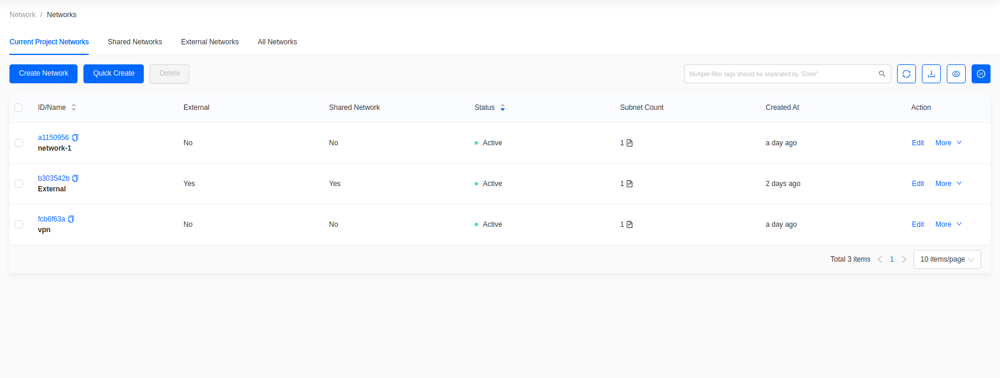
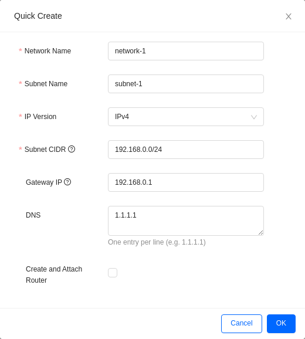
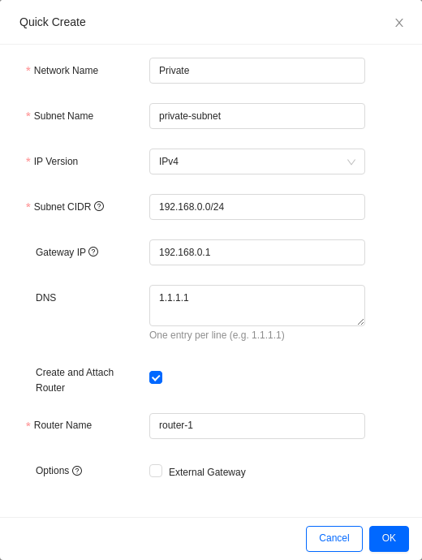
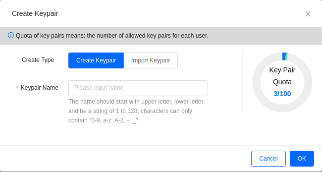
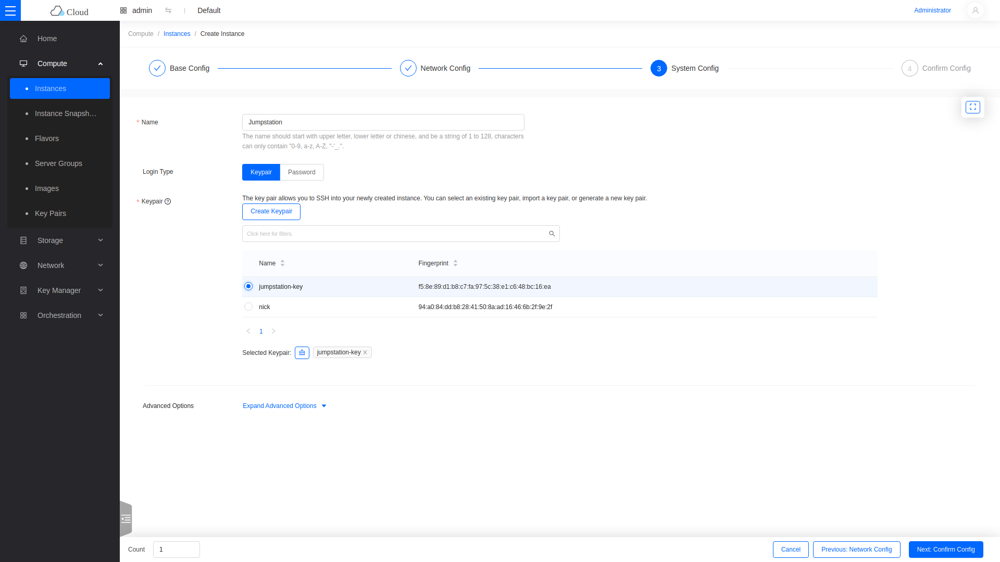
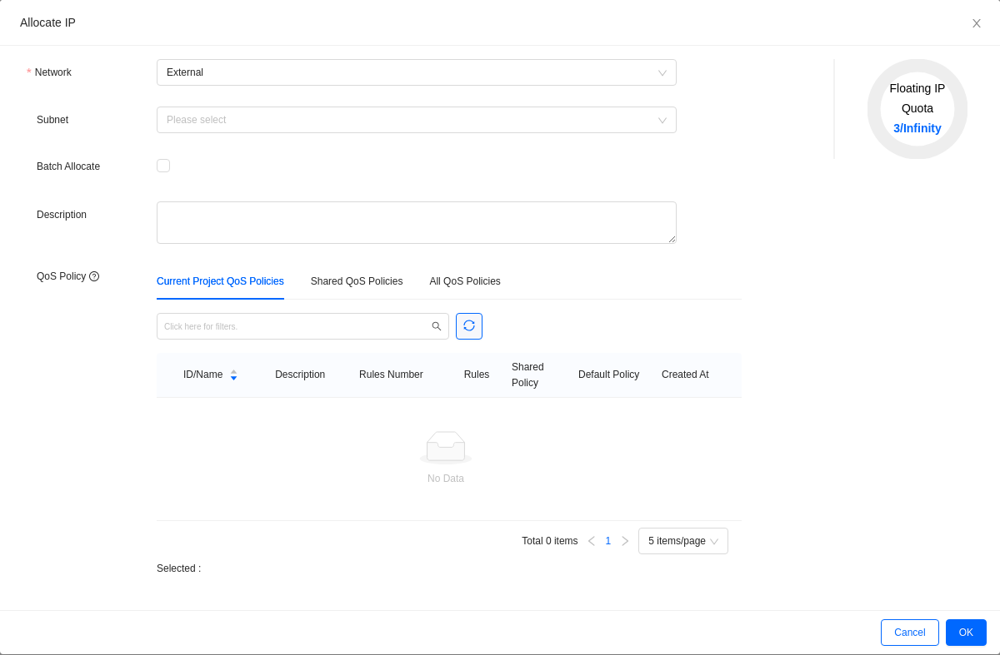

# How to Create an Instance in Skyline

This guide creates a private network, a security group, a key pair, and an
instance,
then attaches a floating IP so the instance is reachable from outside the cloud.

## Create a network and router

**Quick Create** builds the network, its subnet, and an attached router in one
step.

Go to **Network -> Networks**.

Click **Quick Create**.

Fill in the form.

- **Network Name**: **Private**.
- **Subnet Name**: **private-subnet**.
- **IP Version**: IPv4.
- **Subnet CIDR**: a private range, for example `192.168.0.0/24`.
- **Gateway IP**: filled automatically from the CIDR.
- **DNS**: one resolver per line.
- **Create and Attach Router**: check this to create a router and connect it to
  the
  subnet.
- **Router Name**: the router name.
- **Options -> External Gateway**: check this. Without it the router has no
  route to
  the **External** network and floating IPs will not work.

Click **OK**.

To build the pieces separately instead, use **Create Network** on this page and
**Create Router** under **Network -> Routers**, then attach the subnet with
**More -> Connect Subnet** on the router.

### View the topology

Go to **Network -> Topology**.

## Create a security group

Security groups control traffic to and from instances. The **default** group
denies
all inbound traffic and allows all outbound traffic.

Go to **Network -> Security Groups**.

Click **Create Security Group**.

Name it **SSH**, then click **OK**.

### Add an SSH rule

Open the **SSH** group.

Click **Create Rule**.

- **Protocol**: TCP.
- **Direction**: Ingress.
- **Ether Type**: IPv4.
- **Port Type** / **Port or Port Range**: port `22`.
- **Remote Type**: CIDR.
- **Remote IP Prefix**: the source allowed to connect. Use the IP of a control
  plane
  node to permit SSH only from inside the cloud, rather than `0.0.0.0/0`.

Click **OK**.

Open only the ports you need, to the narrowest source range that works.

## Add a key pair

An SSH key is injected at boot. It cannot be added to a running instance.

Go to **Compute -> Key Pairs**.

Click **Create Keypair**.

- **Create Type**: choose to generate a new key pair or import an existing
  public key.
- **Keypair Name**: the name shown when launching an instance.
- **Public Key**: paste the public key when importing.

To create a key pair on a control plane node first, see
[Create SSH Key Pair for an OpenStack Control Plane
Node](../command-line/create-SSH-key).

## Create the instance

Go to **Compute -> Instances** and click **Create Instance**. This opens a
four-step
wizard.

### Step 1: Base Config

- **Availability Zone**: leave as **Any Availability Zone**.
- **Flavor**: the vCPU, memory, and disk size. This example uses **gen2.small**.
- **Start Source**: **Image**.
- **Operating System**: pick a distribution tab, then the image. This example
  uses
  **Ubuntu 24.04 (Noble)**.
- **Boot From Volume**: **Yes** creates a Cinder volume from the image, stored
  in Ceph.
- **System Disk**: choose a volume **Type**, then a **Size**. The size must be
  at
  least the flavor's disk size, or the wizard will not advance.
- **Delete with the instance**: clear this to keep the volume after the instance
  is
  deleted.
- **Count**: the number of instances to create.

Click **Next: Network Config**.

### Step 2: Network Config

- **Virtual Interfaces**: select the **Private** network.
- **Security Group**: select the **SSH** group.

Attaching an instance directly to **External** consumes a public IP and exposes
it to
the Internet. Use a private network and a floating IP instead.

Click **Next: System Config**.

### Step 3: System Config

- **Name**: the instance name. This example uses **Jumpstation**.
- **Login Type**: **Keypair**.
- **Keypair**: the key pair added earlier.
- **User Data**: optional cloud-init configuration.

Click **Next: Confirm Config**.

### Step 4: Confirm Config

Review the summary and click **OK**.

The instance builds in a few minutes.

## Attach a floating IP

A floating IP makes the instance reachable from outside the cloud.

Go to **Network -> Floating IPs**.

Click **Allocate IP**.

- **Network**: **External**.
- **Count**: how many addresses to allocate.
- **Description**, **QoS Policy**: optional.

Click **OK**.

Find the new address in the list and choose **More -> Associate**, then select
the
**Jumpstation** instance and its port.

The instance is now reachable over SSH from any source permitted by the **SSH**
security group rule.
