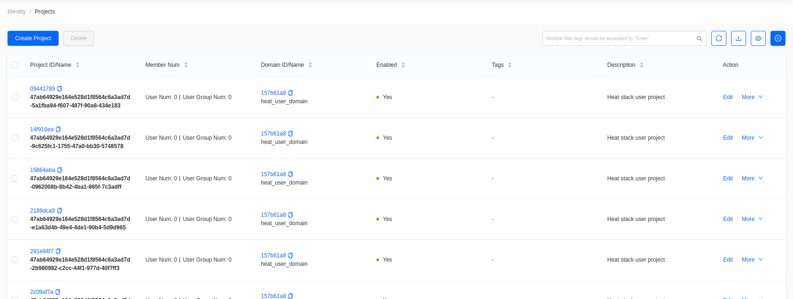

# Create a User and Project in Skyline

Projects and users are managed in the **Administrator** console, under
**Identity**.
Switch to it with the **Administrator** link in the top right.

## Create a project

Go to **Identity -> Projects**.

Click **Create Project**.

- **Name**: the project name. This example uses **Development**.
- **Domain**: leave as `Default` unless you use multiple domains.
- **Status**: leave enabled.
- **Description**, **Tags**: optional.

Click **OK**.

## Set project quotas

Find the project in the list, then choose **More -> Edit Quota**.

Quotas cap what the project may consume — instances, vCPUs, memory, volumes,
floating
IPs, and security groups. Leave a quota blank for unlimited.

## Create a user

Go to **Identity -> Users**.

Click **Create User**. This opens a full page rather than a dialog.

- **Username**: the login name.
- **Password** and **Confirm Password**: the user's initial password.
- **Domain**: leave as `Default`.
- **Project** and **Role**: assign the user to a project and give it a role.
  Assign
  the **Development** project with the `member` role for a standard tenant user,
  or
  `admin` for a cloud administrator.
- **Email**, **Phone**, **Real Name**, **Description**: optional.

Click **OK**.

The new user can now sign in to Skyline and will see only the projects it
belongs to.

## Roles

- `member` — normal tenant access within assigned projects.
- `reader` — read-only access.
- `admin` — full cloud administration, including the Administrator console.

Grant `admin` only to operators who administer the whole cloud.
