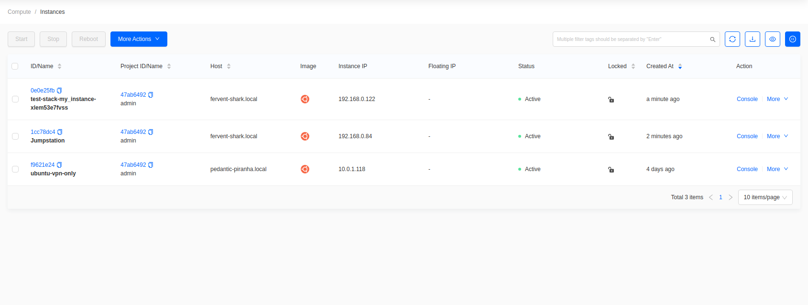
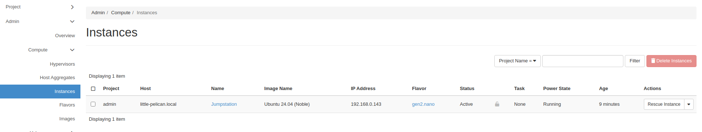
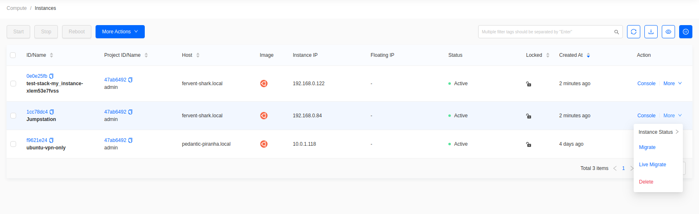
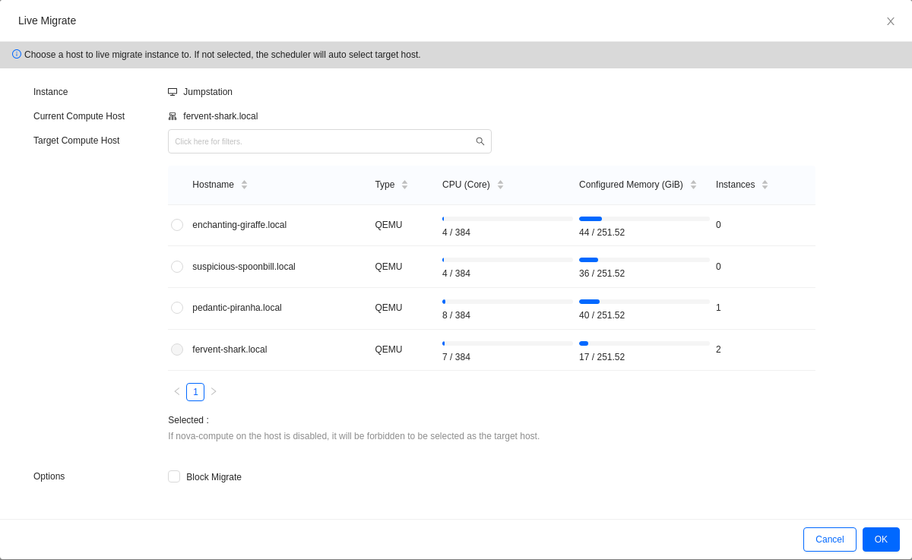
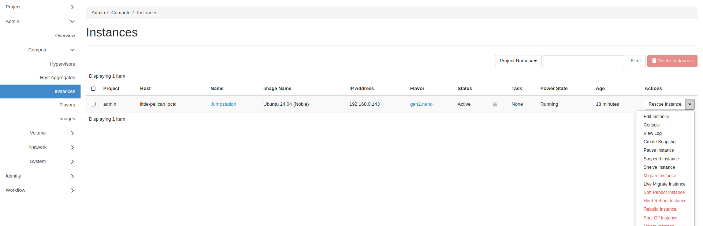
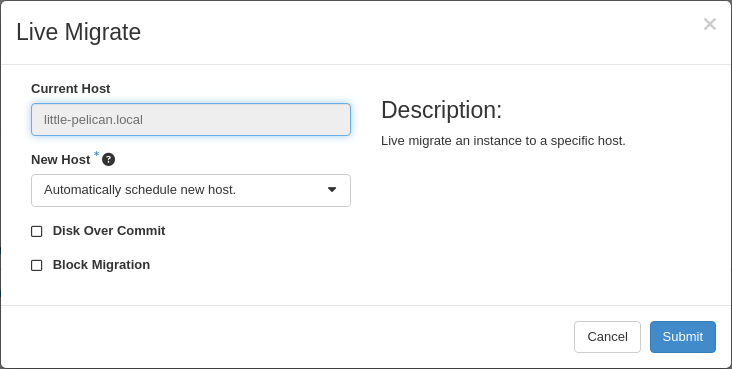

import Tabs from '@theme/Tabs';
import TabItem from '@theme/TabItem';

# How to Live Migrate Instances

## Introduction

This guide provides instructions for cloud administrators on how to
migrate instances through the dashboard. Migration is the
process that a server administrator can move instances to a different
host. Live migration keeps instances in an active state during the
migration process. This process is useful when applications need to
remain running and shutting down an instance is not possible or
advantageous.

## Prerequisite

Live migrating instances requires having a user account with the
administrator role. This is typically the account called **admin**.

## Determining an Instance's Parent Host

<Tabs groupId="dashboard">
<TabItem value="skyline" label="Skyline" default>

Switch to the **Administrator** console and go to **Compute -> Instances**. The list shows each instance's project, host, IP address, and status.

**Figure 1:** Summary of Instances

</TabItem>
<TabItem value="hz" label="Horizon">

Go to **Admin -> Compute -> Instances**. The list shows each instance's project, host, IP address, and status.

**Figure 1:** Summary of Instances

</TabItem>
</Tabs>

## Migrate Instance

<Tabs groupId="dashboard">
<TabItem value="skyline" label="Skyline" default>

In the same list, find the instance and choose **More -> Live Migrate**.

**Figure 2:** Live Migrate action

**Figure 3:** Live Migration Options

- **Instance**: the instance being migrated.
- **Current Compute Host**: read-only, the host it runs on now.
- **Target Compute Host**: leave unset to let the scheduler choose, or pick a specific host.

Click **OK**.

Skyline does not expose the **Disk Over Commit** or **Block Migration** options that Horizon offers. Both apply only to local ephemeral storage.

</TabItem>
<TabItem value="hz" label="Horizon">

In the same list, open the actions menu at the end of the instance's row and choose **Live Migrate Instance**.

**Figure 2:** Live Migrate action

**Figure 3:** Live Migration Options

- **Current Host**: read-only, the host it runs on now.
- **New Host**: leave on **Automatically schedule new host**, or pick one.
- **Disk Over Commit** and **Block Migration**: leave both unchecked.

Click **Submit**.

</TabItem>
</Tabs>

The instance's **Status** changes while it migrates, and its **Host** updates when the migration completes.

OpenMetal uses shared storage through Ceph, so block migration is not required.
