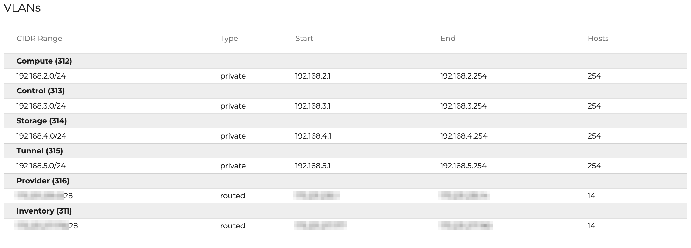
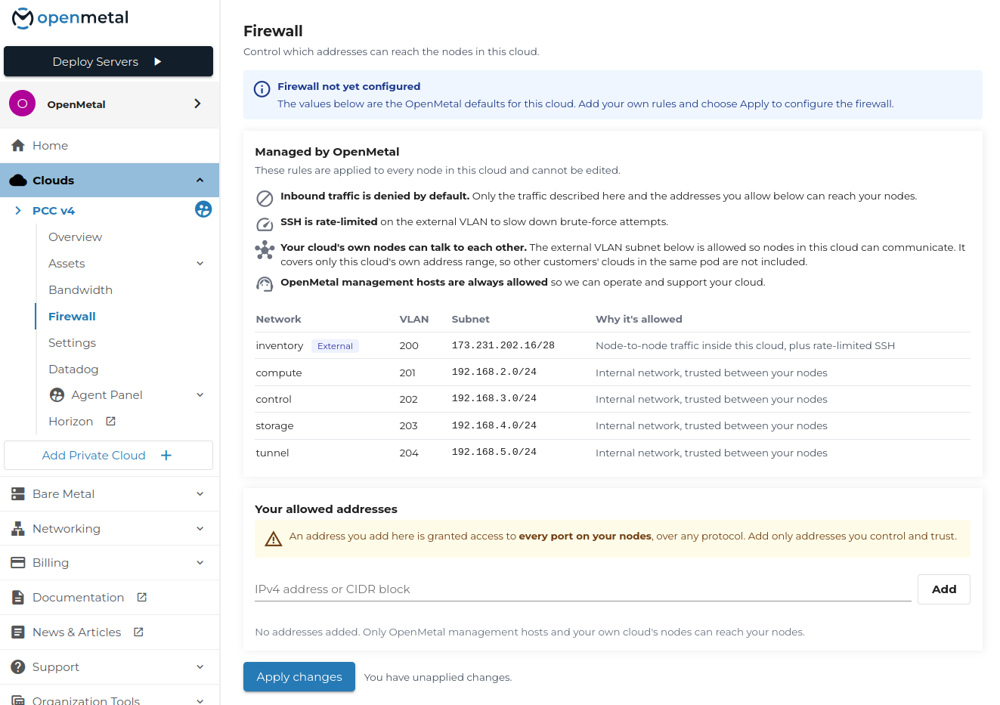

# Manage the Node Firewall

PCC v4 deploys a host firewall to every node. It is built from `ufw` and `ipset` by the `firewall-ansible` playbook and is applied by default. There is nothing to install.

## Default policy

| Interface | Policy |
|---|---|
| External, internet-facing | Deny inbound. SSH on port 22 is open and rate-limited. |
| Management, `bond0.8` | Deny inbound. The first four usable addresses of its subnet are whitelisted. |
| All other VLANs | Allow all traffic. |

Control, storage, tunnel, compute, and any cross-cluster link to a sibling PCC cluster fall under "all other VLANs". There is no restricted middle tier. An interface is either external or fully trusted.

IPv6 is disabled in `ufw`. Logging is set to `low`.



## Whitelists

Two ipsets hold the addresses allowed past the default deny policy.

| Set | Contents | Managed from |
|---|---|---|
| `customer_whitelist` | Subnets you trust | Central's Firewall UI |
| `omi_whitelist` | OpenMetal VPN endpoints, pod ranges, and the pod management hosts | OpenMetal |

An entry in either set gets unrestricted access to every port and protocol on the node, not only the ports `ufw` opens. Treat a whitelist entry as a fully trusted host.

Add your own addresses under **Clouds -> your cloud -> Firewall** in OpenMetal Central. Enter an IPv4 address or CIDR block, click **Add**, then **Apply changes**. The page also lists the rules OpenMetal manages, which you cannot edit.



`omi_whitelist` is managed by OpenMetal and is not editable from Central.

## Inspect the firewall

```shell
ufw status verbose
ipset list omi_whitelist
ipset list customer_whitelist
```

## Persistence

Do not change the firewall on the node. Manual `ipset add` and `ipset del` take effect immediately and are lost the next time OpenMetal's deployment automation runs or the node boots. Both sets are rebuilt from their managed source:

- Ansible re-renders them under `/etc/firewall-ansible/` on every run.
- The `firewall-ansible-ipsets.service` systemd unit restores them at boot, before `ufw` starts.

Changes that need to survive go through Central, or through our team for anything Central does not expose yet.

## Open an additional port

Opening a port beyond SSH is not self-service yet. [Submit a support ticket](../day-1/intro-to-openmetal-private-cloud.md#submit-a-support-ticket) with the port, the protocol, and which addresses should reach it, and our team applies the rule for you.

This is coming to Central.
