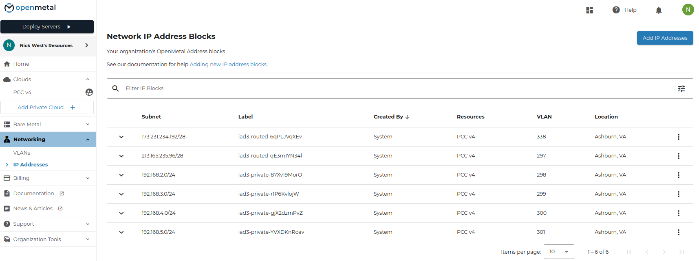
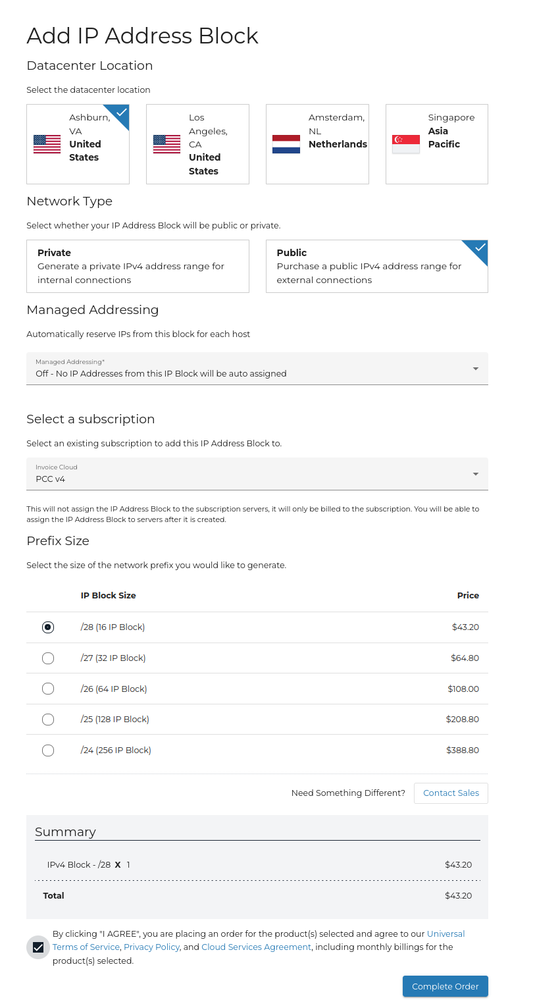
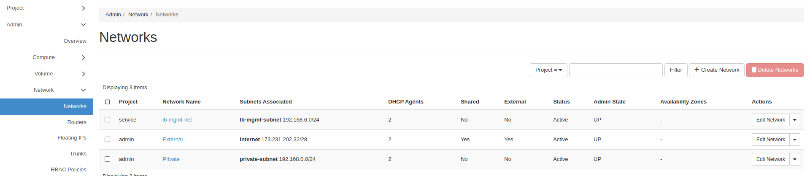
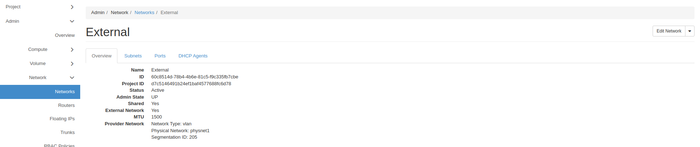
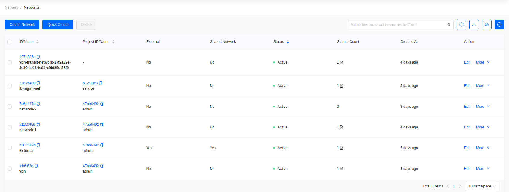
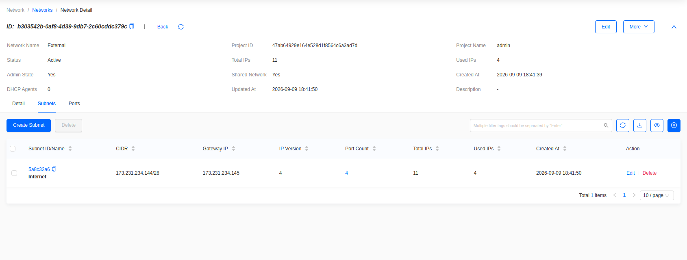

import Tabs from '@theme/Tabs';
import TabItem from '@theme/TabItem';

# How to Add Additional Provider IP Blocks

## Introduction

With OpenMetal Private Clouds, multiple provider IP blocks are
supported. This guide explains how to add an additional provider IP
block and how to confirm it reached your cloud.

## Add the IP block

In OpenMetal Central, go to **Networking -> IP Addresses**. The page lists
your organization's existing blocks with their subnet, label, VLAN, and the
cloud each one belongs to.

**Figure 1:** Network IP Address Blocks

Select **Add IP Addresses**.

| Field | Value |
|---|---|
| Datacenter Location | The location of your cloud |
| Network Type | Public |
| Managed Addressing | Off |
| Select a subscription | The cloud to bill the block to |
| Prefix Size | The size of the block |

Managed addressing must be off.

**Figure 2:** Add IP Address Block

Agree to the terms and select **Complete Order**.

### Add the Block to OpenStack

Ordering the block in Central does not add it to OpenStack. That step is not
automated yet.
[Submit a support ticket](../day-1/intro-to-openmetal-private-cloud.md#submit-a-support-ticket)
once the order completes and our team adds the block to your cloud.

### Confirm new Provider Block Addition

First to confirm the addition of the IP block, log in with a user that has the administrator role. This is typically the account called "admin".

<Tabs groupId="dashboard">
<TabItem value="hz" label="Horizon" default>

Go to **Admin -> Network -> Networks**, then click the **External** network.

**Figure 3:** List of Networks

The network detail page lists its subnets. Confirm the new subnet has been added.

**Figure 4:** List of Subnets for the External network

</TabItem>
<TabItem value="skyline" label="Skyline">

Switch to the **Administrator** console, go to **Network -> Networks**, then click the **External** network.

**Figure 3:** List of Networks

Choose the **Subnets** tab and confirm the new subnet has been added.

**Figure 4:** List of Subnets for the External network

</TabItem>
</Tabs>

The new subnet will be prefixed with **Internet\_** and will have a
series of hex values following it.

### How are the new Provider Block IPs Used?

When creating a resource that requires an IP from this block, specify
the name of the newly added provider block to add IPs from it.
