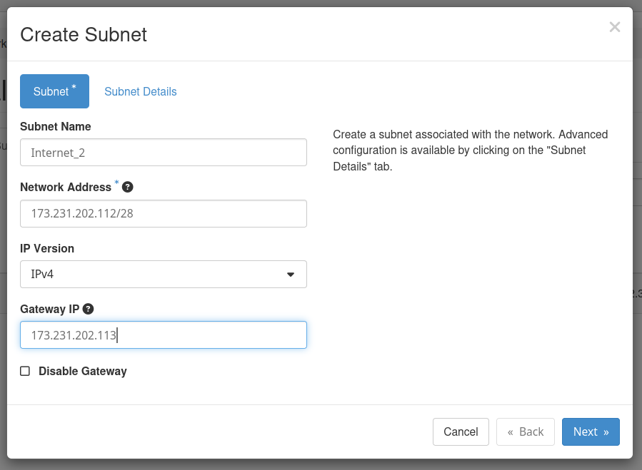
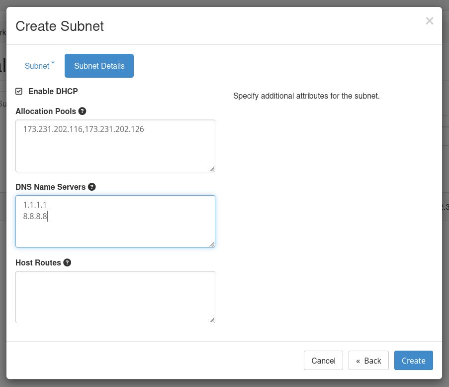
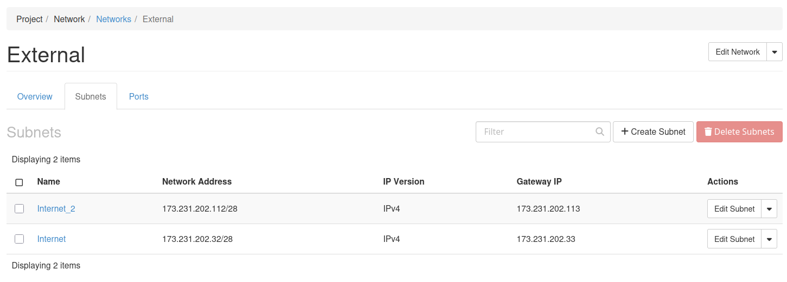
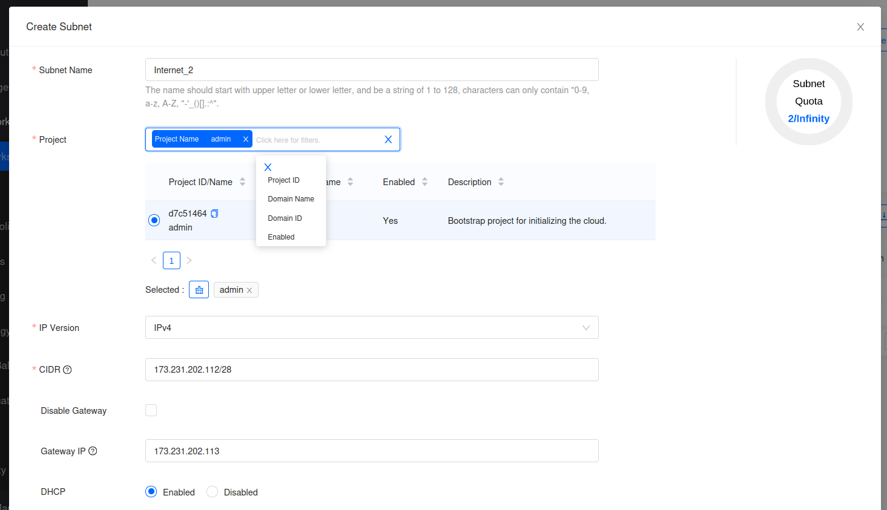
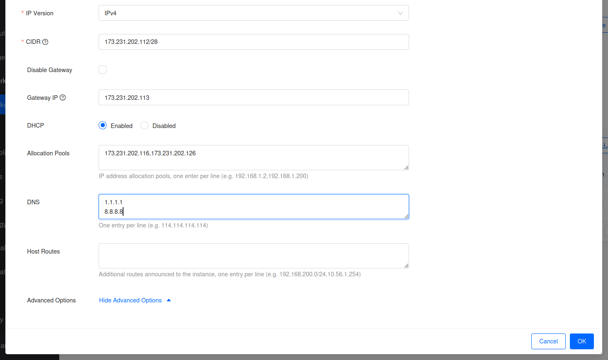
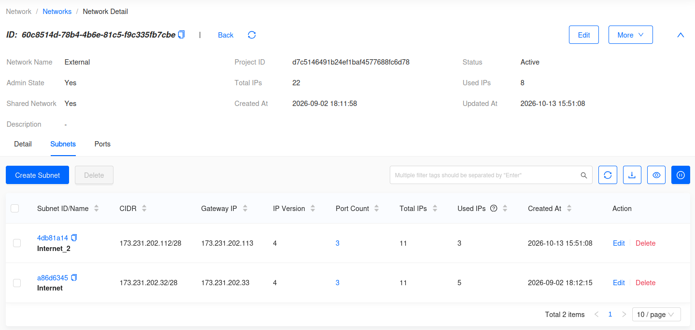

import Tabs from '@theme/Tabs';
import TabItem from '@theme/TabItem';

# How to Add Additional Provider IP Blocks

## Introduction

With OpenMetal Private Clouds, multiple provider IP blocks are
supported. This guide explains how to add an additional provider IP
block and add it to your cloud as a subnet.

### What is a provider IP block?

This is a public subnet that is associated with your cloud's External OpenStack
network. Your cloud comes with a single provider subnet by default. Floating IPs
are assigned from this network. This is the subnet you would typically use to
route public internet traffic to VMs in your cloud.

## Add the IP block

To add a new provider IP block, first follow this Central guide: [Adding new IP Blocks to a Cloud's External Provider Network](/openmetal-central/adding-ip-addresses)

## Create the subnet in OpenStack

Once the order completes, add the block to the **External** network as a new subnet. Log in as a user with the administrator role, typically **admin**.

Use these values, shown for the example block `173.231.202.112/28`:

| Field | Value | Example |
|---|---|---|
| Subnet Name | `Internet_` followed by a number | `Internet_2` |
| Network Address / CIDR | The block | `173.231.202.112/28` |
| IP Version | IPv4 | IPv4 |
| Gateway IP | First usable address | `173.231.202.113` |
| DHCP | Enabled | Enabled |
| Allocation Pools | Fourth usable address to the last usable address | `173.231.202.116,173.231.202.126` |
| DNS Name Servers | One per line | `1.1.1.1` and `8.8.8.8` |

<Tabs groupId="dashboard">
<TabItem value="hz" label="Horizon" default>

**Step 1** -- Go to **Project -> Network -> Networks**, click the **External** network, choose the **Subnets** tab, and click **Create Subnet**.

**Step 2** -- On the **Subnet** tab, enter the name, network address, IP version, and gateway IP. Click **Next**.

**Figure 1:** Create Subnet

**Step 3** -- On the **Subnet Details** tab, leave **Enable DHCP** checked and enter the allocation pool and DNS name servers. Click **Create**.

**Figure 2:** Subnet Details

**Step 4** -- Confirm the new subnet is listed.

**Figure 3:** Subnets of the External network

</TabItem>
<TabItem value="skyline" label="Skyline">

**Step 1** -- Switch to the **Administrator** console, go to **Network -> Networks**, click the **External** network, choose the **Subnets** tab, and click **Create Subnet**.

**Step 2** -- Enter the subnet name, select the **admin** project, and enter the IP version, CIDR, and gateway IP.

**Figure 1:** Create Subnet

**Step 3** -- Leave **DHCP** enabled, enter the allocation pool and DNS servers, and click **OK**.

**Figure 2:** Allocation Pools and DNS

**Step 4** -- Confirm the new subnet is listed.

**Figure 3:** Subnets of the External network

</TabItem>
</Tabs>

## Reserved addresses

Each provider block reserves its first three usable addresses for the OpenMetal routers upstream of your cloud. They must stay outside the allocation pool.

| Address | Example | Use |
|---|---|---|
| Network address | `.112` | Not usable |
| First usable | `.113` | Gateway, a virtual IP shared by the two routers over VRRP |
| Second usable | `.114` | First router |
| Third usable | `.115` | Second router |
| Fourth usable to last usable | `.116` - `.126` | Allocation pool |
| Broadcast address | `.127` | Not usable |

A `/28` leaves 11 addresses for your cloud. Neutron uses some of these for its own ports, such as DHCP and metadata, so a new subnet shows addresses in use before you assign any.

## Using the new IPs

When creating a resource that needs an IP from this block, such as a floating IP or a router gateway, select the new subnet.
