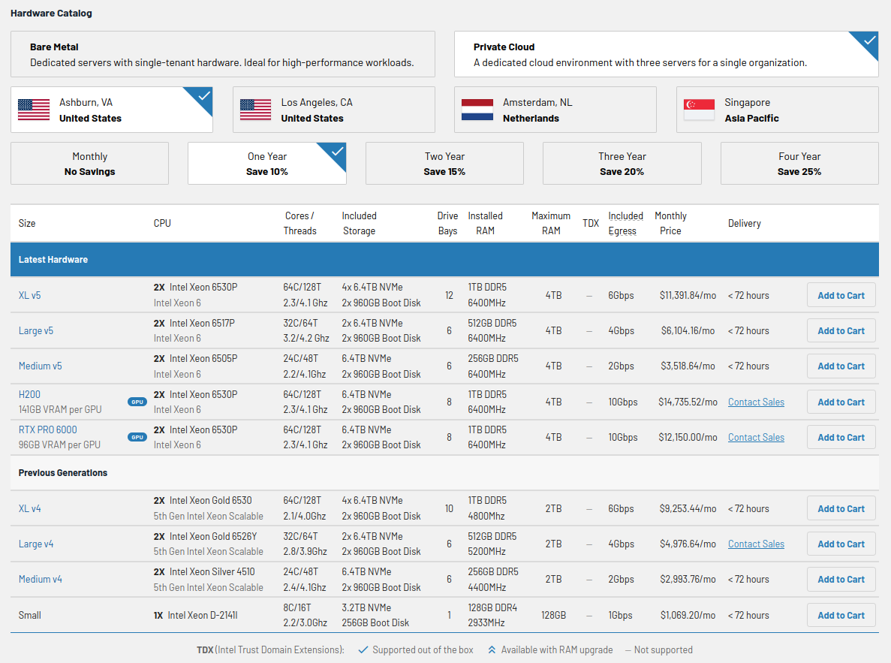
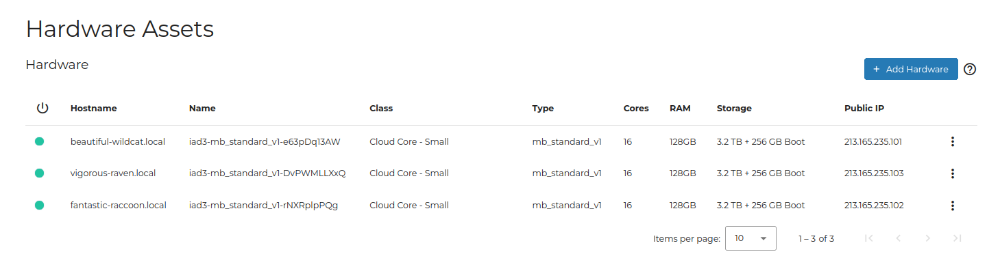
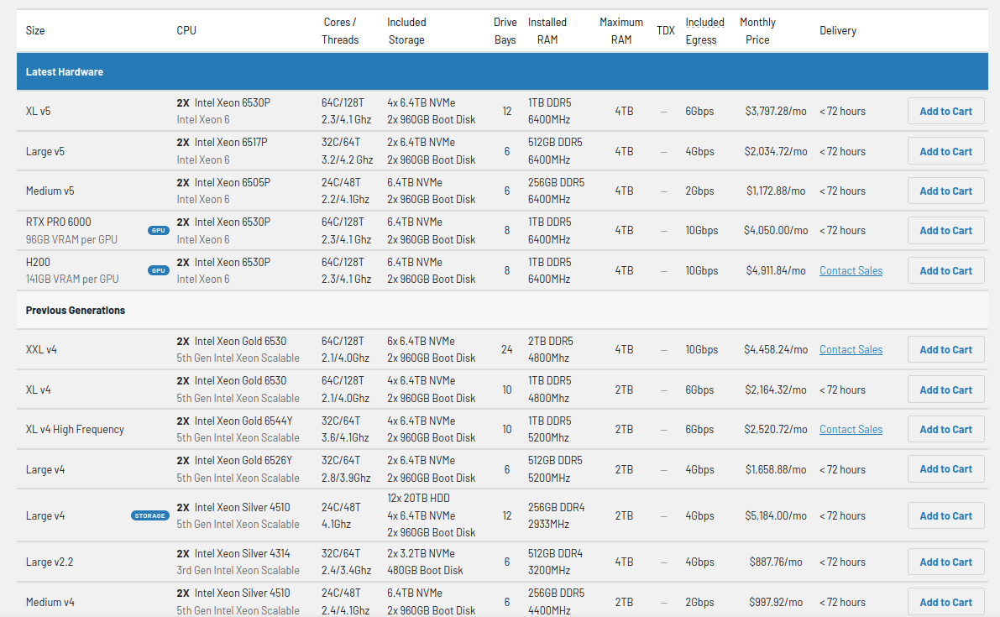
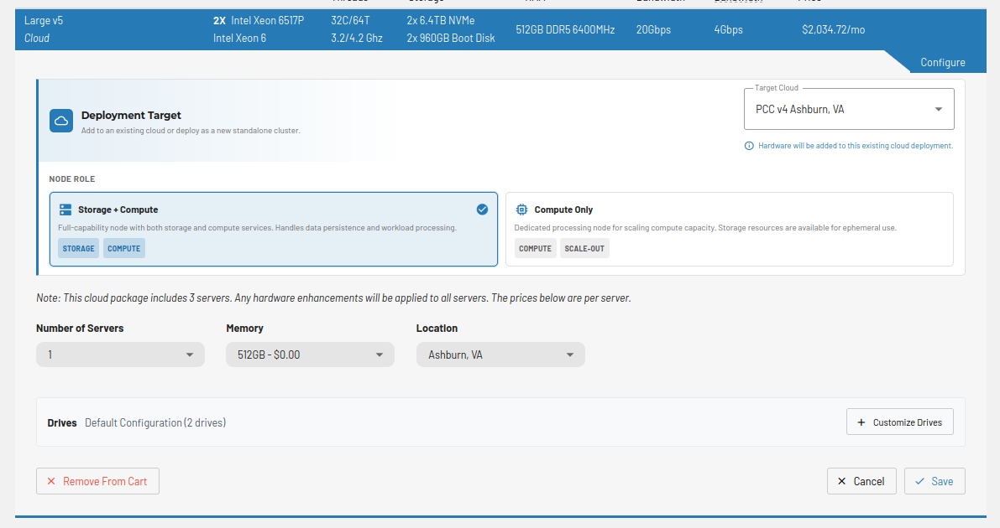
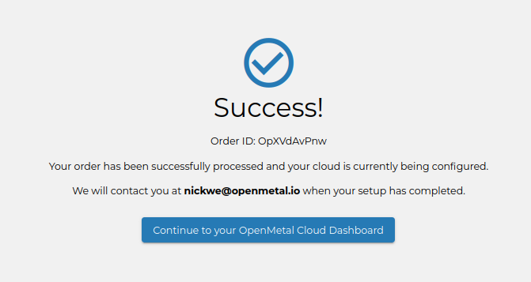
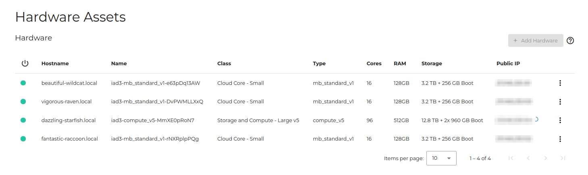

# How to Add or Remove OpenStack Hardware Nodes

## Introduction

OpenMetal Private Clouds can have hardware nodes added to them,
increasing the available compute and storage resources to your cloud.
Similarly, hardware nodes can be removed should resources no longer be
required. In this guide we explain best practices when selecting new
hardware nodes for your cloud. Next we cover how to add nodes, which
types of nodes you can add, and the process for removing nodes from your
cloud.

## Cloud Hardware Selection

In this section we outline the types of clouds offered, the types of
nodes you can add to your cloud, and best practices when choosing
hardware for your Private Cloud. Additionally we explain conditions
under which your cloud's Ceph cluster is affected when adding hardware.

### Types of Private Clouds

Private Clouds come in three sizes: **Medium**, **Large**, and **XL**. Each
is a cluster of three servers.

Sizes are versioned. As new hardware becomes available we add a version, so
a size exists in more than one generation and older generations stay
available for a time.

**Figure 1:** Hardware Catalog

The hardware catalog lists each size with its CPU, cores, storage, RAM, and
price, for the location and term you choose. GPU sizes are listed alongside
them.

To work out which size fits your workload,
[book a meeting](https://openmetal.io/schedule-meeting/) with our team.

### Types of Nodes

A node is added in one of two roles:

- **Storage + Compute**: a full-capability node providing both storage and
    compute. It handles data persistence as well as workload processing.
- **Compute Only**: a dedicated processing node for scaling compute capacity.
    Its storage is available for ephemeral use.

Nodes come in the same sizes as clouds, with XXL and GPU nodes available in
addition. Some sizes have variants, such as a high frequency CPU option or a
storage configuration with more drive bays. Previous generations stay
available alongside the latest hardware, so node sizes carry a version in the
same way cloud sizes do.

### The Benefit of Homogeneous Clouds

By default, Private Clouds are hyper-converged and include a Ceph
deployment. Generally speaking, Ceph is only as fast as your slowest
node allows, though there are caveats to this. Ceph could be impacted by
the type of nodes added to a cluster due to potential differences in
hardware, such as performance disparity between storage provided by
HDDs, SSDs or NVMes. Having a homogeneous cluster of similarly equipped
nodes will have the best results in terms of performance and data
density. Additionally, while you can add any hardware node to your
cloud, the Network Interface Cards (NICs) for each designation of node
may have a different maximum throughput. If a node with a 1Gbit NIC is
added to a cluster with nodes having 10Gbit NICs, the internal network
traffic is limited by the additional node.

## Adding Hardware Nodes to a Cloud

In this section, we explain the steps needed to add hardware nodes to
your cloud.

The following demonstrates adding a **Storage and Compute - Standard**
node to a **Cloud Core - Standard** cloud.

### How to add a Hardware Node

#### Navigate in OpenMetal Central to Cloud Assets Page

First navigate in OpenMetal Central to your cloud's details page. Next
follow the **Assets** link on the left. This page shows you details
about your cloud's current assets and also allows you to add a new
hardware node. To add a new hardware node, select the **Add Hardware**
button located at the top right.

**Figure 2:** Add Hardware

#### View Hardware Node Types

The next screen lists the hardware you can add.

**Figure 3:** Available Hardware List

Each row gives the CPU, cores and threads, included storage, drive bays,
installed and maximum RAM, egress, monthly price, and delivery time. The
latest hardware is listed first, with previous generations below it.

Choose a size and select **Add to Cart**.

#### Configure the Node

Set the deployment target to your existing cloud, then choose the node role,
the number of servers, the memory, and the location. Drives use the default
configuration unless you customize them.

**Figure 4:** Configure the Node

Select **Save**, then place the order. A confirmation is returned once the
order is processed.

**Figure 5:** Hardware Addition Success

**Note** -- Adding a hardware node can take around an hour to complete.
An email is sent to the primary account's address when complete.

#### Verify Hardware Addition Success

Navigate to your cloud's assets page to confirm the newly added node.

**Figure 6:** Successful Hardware Node Addition

## Removing Hardware Nodes from a Cloud

In this section, we outline the steps required to remove a hardware node
from your cloud.

Copy any data you need from the node before removing it. Removal cannot be
undone.

### Consider Before Removing

At all times, your cloud must have three hyperconverged control plane
nodes running to have a fully functioning OpenStack cloud. As such, the
node being removed cannot be a control plane node.

Control plane nodes in OpenMetal Central are prefixed with **Cloud
Core** and can be distinguished from other nodes by inspecting the
**Class** column in your cloud's assets page in OpenMetal Central.

For example, in the following screenshot the three nodes classified
**Cloud Core - Small** are control plane nodes:

**Figure 7:** Control Plane nodes

The remaining node, classified **Storage and Compute - Large v5**, is not a
control plane node, meaning it does not run all the core OpenStack
services.

### Initial Preparation

To prepare for removal of a hardware node, migrate any instances to
another node that has compute services running. All hyperconverged nodes
run OpenStack's compute service. For instruction regarding migrating
instances to another node, see the [How to Live Migrate
Instances](../day-2/live-migrate-instances) guide.

### How to Remove a Hardware Node from a Cloud

Open the three dots menu at the end of the node's row and choose
**Remove**.

The same menu holds the other per-node actions: **Details**, **Edit Node**,
**IPMI Access**, the power and restart controls, **Reprovision Node**, and
**Replace Node**.
