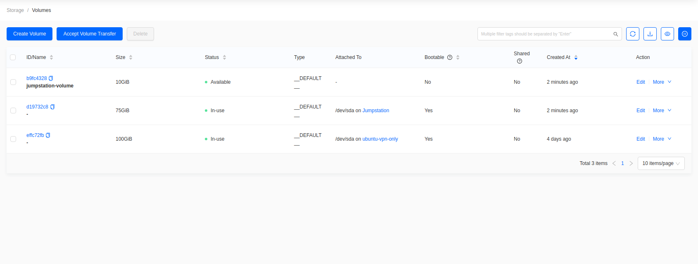
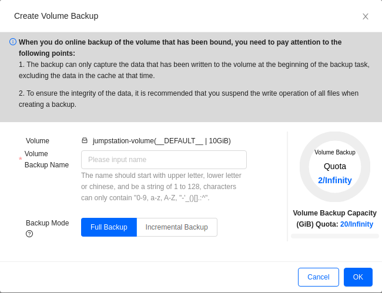
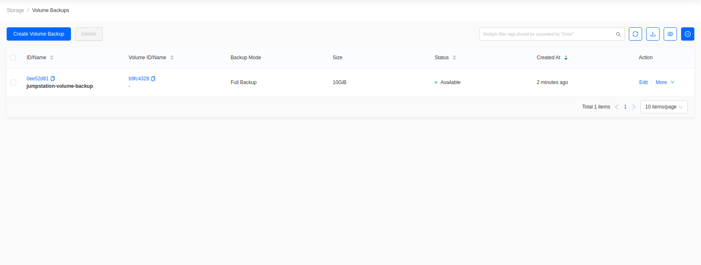
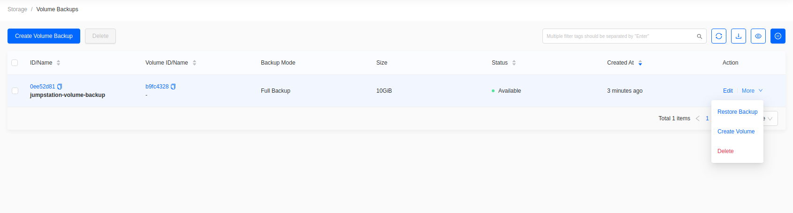

# Create and Restore Volume Backups

## Introduction

With Private Clouds, you have the ability to create backups and
snapshots of your volume data. If a volume's data goes corrupt or is
removed by mistake, having a copy of that data could be invaluable. In
this guide, we explain how to create and recover volume backups using
Skyline.

## Create a Volume Backup

In Skyline, go to **Storage -> Volumes**.

**Figure 1:** Volumes List

Find the volume and choose **More -> Data Protection -> Create Backup**.

**Figure 2:** Create Volume Backup Form

- **Volume**: read-only, the volume being backed up.
- **Volume Backup Name**: a name for the backup.
- **Backup Mode**: **Full** copies the whole volume. **Incremental**
    copies only the blocks changed since the last backup, and requires
    an existing full backup of that volume.

On a Private Cloud, volume backups are stored in the Ceph pool called
`backups`.

Submit the form, then go to **Storage -> Volume Backups** to see the
backup.

**Figure 3:** Volume Backup List

### Test Volume Backups

Creating backup copies of your important data is only one part of having
a solid backup and recovery plan. Additionally, consider testing
backed-up data to ensure if something unexpected does happen that
restoring your backups will actually be useful. To test volume backups,
you can restore a volume backup within OpenStack alongside the original
volume and compare the contents.

## Restore a Volume Backup

To restore a volume backup, go to **Storage -> Volume Backups**.

Find the backup and choose **More -> Restore Backup**.

**Figure 4:** Volume Backup List

Choose the volume to restore into. Leave it unset to restore into a new
volume.

## Ceph, Volumes, and Data Durability

When volume backups are created, they are stored in your cloud's Ceph
cluster in a pool called `backups`. By default, the Ceph cluster is
configured with host level replication across each of your cloud's three
control plane nodes. With this configuration, your cloud could suffer
losing all but one Ceph node and still retain all of the cluster's data.
For more about how your Ceph cluster was configure, see the heading
**Default Configuration for the Ceph Cluster** in the
[Introduction to Ceph](../day-2/introduction-to-ceph) guide.

## Store Data Outside of the Cloud

Taking data backups a step further, consider storing critical data
outside of the cloud. Storing data both in the cloud's Ceph cluster as
well as outside of it increases the failure domain.

With Ceph you can use [RBD mirroring](https://docs.ceph.com/en/latest/rbd/rbd-mirroring/),
which effectively is a way to mirror your Ceph cluster's data to another Ceph
cluster.
